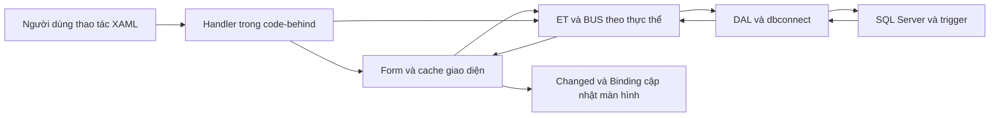

# Giải thích code và phạm vi hỗ trợ AI

Tài liệu này giải thích source hiện có ngày 13/10/2026. Chú thích chi tiết được đặt ngay trên các lớp, hàm, constructor, thuộc tính và vùng XAML để đọc cùng code trong Visual Studio. Các thay đổi chức năng gồm chỉnh ô tiền/lý do, chuyển control sang XAML và bổ sung [kiểm tra nhập liệu tại giao diện](KIEM_TRA_NHAP_LIEU.md).

## 1. Quy ước ghi nhận AI

Toàn bộ 133 file giao diện WPF (72 file C# và 61 file XAML) có nhãn `PHẦN AI ĐÃ THỰC HIỆN`, mô tả cụ thể công việc AI đã tạo, chuyển sang XAML, chỉnh sửa hoặc bổ sung giải thích. Tra [phần AI đã thực hiện trong giao diện](PHAN_AI_THUC_HIEN_GIAO_DIEN.md) để xem từng file. Nhãn chung đã được rút gọn thành `// Nhãn này ghi nhận phần hỗ trợ/chú thích;`.

Các phần AI đã tạo/chuyển đổi gồm bố cục và dữ liệu binding cho ChartView, ScheduleView, RecordDetails và InvoiceDocument; các hàm xử lý trong bốn file tương ứng có XML `remarks` ghi rõ công việc. AI đã thay phần dựng bảng hóa đơn bằng C# bằng mẫu XAML và bộ phân trang; style `PaymentTextInput` trong [HoaDon.xaml](RangHamMat.Wpf/Views/HoaDon.xaml) ghi rõ việc chỉnh ô tiền/lý do cao 38 DIP. Những file chỉ được bổ sung giải thích sẽ ghi đúng công việc chú thích tại đầu file.

Phạm vi giao diện được giải thích gồm XAML, code-behind, control dùng chung, model hiển thị/nháp và luồng gọi BUS từ giao diện. Các lớp ET được giải thích về ánh xạ cột và truyền dữ liệu. Chương trình kiểm tra được chú thích để biết cách xác minh các chức năng liên quan.

Theo yêu cầu mở rộng trước đó, toàn bộ 39 lớp DAL và 39 lớp BUS cũng đã được chú thích, cùng [dbconnect.cs](DAL/dbconnect.cs) và [XuLyLoi.cs](BUS/XuLyLoi.cs). Mỗi lớp/hàm nêu mục đích, tham số, cách đọc/lưu/kiểm tra, giao dịch và kết quả. Lượt bổ sung nhãn công việc AI trong giao diện này không thêm nhãn mới vào DAL, BUS và ET; ở ba tầng đó chỉ rút gọn đúng dòng nhãn được yêu cầu. Token thực thi của 80 file BUS/DAL được giữ nguyên.

## 2. Cấu trúc dự án và cách đọc

| Nơi chứa | Trách nhiệm | Khi nào được chạy |
|---|---|---|
| `RangHamMat.Wpf/Views/*.xaml` | Bố cục màn hình, nhãn, trường nhập, bảng, tab, binding và tên handler | WPF nạp control bằng `InitializeComponent` |
| `Views/*.xaml.cs` | Xử lý lựa chọn/bấm nút, kiểm tra đầu vào, mở form, gọi luồng lưu và báo lỗi | Sự kiện XAML hoặc màn hình cha gọi |
| `MainWindow` | Trang chủ, vai trò đang xem, bộ lọc phân hệ và mở ứng dụng | Khởi động và chuyển phân hệ |
| `AppWorkspace` | Khung phân hệ, modal, lịch sử quay lại, bắt các nút có `Tag` | Khi mở ứng dụng hoặc biểu mẫu |
| `Controls` | Cache trình bày, form theo Tag, điều hướng hồ sơ, lịch/đồ thị và các model | Code-behind và binding gọi |
| `Themes` | Màu, font, template control, template chi tiết, trạng thái focus/disabled | Control tra `StaticResource`/`DynamicResource` |
| `ET` | Dữ liệu thực thể ánh xạ bảng/cột SQL, gồm khóa chuỗi, nullable, decimal/ngày/giờ | Dapper đọc dữ liệu hoặc form chuyển giá trị để gửi BUS |
| `BUS` | API nghiệp vụ từng thực thể và chứng từ, kiểm tra và gọi DAL | Giao diện gửi thao tác đọc/lưu/xác nhận |
| `DAL` | Truy vấn/thêm/sửa/xóa SQL, ràng buộc liên kết, khóa dữ liệu và giao dịch | BUS gọi |
| `Database/QLBenhVienRangHamMat.sql` | Schema v8, khóa ngoại, cột tính, trigger, view và dữ liệu khởi tạo | Khi cài database; các trigger/view hoạt động tại SQL |
| Các dự án `*Checks` và `WpfSmoke` | Kiểm tra cấu trúc, ánh xạ ET, persistence, tài chính và control WPF | Chạy lệnh kiểm tra, không phải màn hình nghiệp vụ |

Muốn hiểu một chức năng: tìm nút/trường trong XAML → đọc handler cùng tên trong `.xaml.cs` → theo hàm `BieuMauHoSo`/`DuLieuGiaoDien` hoặc BUS được gọi → xem ET của bảng và ràng buộc SQL. `/// 
` xuất hiện cả trong tooltip IntelliSense; comment `//` giải thích các đoạn xử lý bên trong hàm; comment `<!-- -->` giải thích XAML.

## 3. Khởi động, vai trò và điều hướng

[App.xaml.cs](RangHamMat.Wpf/App.xaml.cs) mở `DangNhap` bằng `ShowDialog`. `DialogResult=true` thì tạo `MainWindow`; hủy/đóng hộp thoại thì `Shutdown`. Sau khi cửa sổ chính mở, `ShutdownMode.OnMainWindowClose` quy định đóng cửa sổ chính sẽ kết thúc ứng dụng.

Trong source hiện tại, [DangNhap.xaml.cs](RangHamMat.Wpf/Views/DangNhap.xaml.cs) chỉ trả kết quả đồng ý hoặc hủy, chưa kiểm tra tên đăng nhập/mật khẩu với SQL. `RolePicker` và `RolePermissions` của [MainWindow.xaml.cs](RangHamMat.Wpf/MainWindow.xaml.cs) quyết định màn hình được xem theo vai trò chọn tại giao diện; không nên trình bày chức năng này thành hệ thống đăng nhập/phân quyền tài khoản đã hoàn chỉnh.

`OpenApp` chọn control theo tên phân hệ, nạp SQL khi mở bệnh nhân/lịch/khám/dịch vụ/đơn/hóa đơn, rồi đặt vào `AppWorkspace`. Tìm kiếm trang chủ kết hợp tên ứng dụng, nhóm chức năng và danh sách quyền. Các nút có `Tag=MoTrang:...`, `MoCuaSo:...`, `DongCuaSo`, `VeTrangChu`, `HoSoSave` được xử lý tập trung tại `AppWorkspace.Navigate`.

Modal khóa màn hình phía sau, giữ lịch sử form lồng nhau và focus bàn phím. `ReturnToPage` đóng form hiện tại hoặc quay về màn hình trước. Escape đi qua cùng luồng quay lại. Nhấp đúp dòng DataGrid dùng `Tag=Table:TEN_BANG` để mở đúng chi tiết; nhân viên dùng cửa sổ riêng nhận `ET_NHANVIEN` của dòng đã chọn.

`DieuHuongHoSo.Open` truyền đồng thời `patientId`, `visitId`, `prescriptionId`. Workspace kiểm tra bệnh nhân còn tồn tại, lần khám thuộc bệnh nhân, đơn thuốc thuộc đúng lần khám trước khi chuyển. Mã sai trả trạng thái trống/thông báo lỗi, không lấy bản ghi đầu tiên của người khác để thay thế.

## 4. Cache, binding và cập nhật màn hình

[DuLieuGiaoDien.cs](RangHamMat.Wpf/Controls/DuLieuGiaoDien.cs) giữ `ObservableCollection<object>` theo tên bảng. Các dòng được chuẩn hóa thành dictionary động để đọc cùng cách dù nguồn là ET hoặc `DataRowView`. Cache là bản dữ liệu phục vụ hiển thị; các luồng lưu vẫn đi qua BUS/DAL đến SQL.

`EnsureLoaded` đọc dữ liệu ở lần đầu. `RefreshFromDatabase` đọc toàn bộ snapshot trước khi thay collection; lỗi kết nối không làm mất danh sách đang xem. `Find` tìm theo đúng khóa chính; `Children` tìm theo khóa ngoại; `PatientId` lần theo chuỗi quan hệ về bệnh nhân. `Lookup` đổi mã thành tên dễ đọc, còn `Options` tạo `Value` và `Label` cho ComboBox.

[UiRecord.cs](RangHamMat.Wpf/Controls/UiRecord.cs) đọc dictionary/property, đổi `DBNull` thành `null`, định dạng chuỗi/ngày/giờ và chuyển dictionary sang ET đúng kiểu. Ví dụ ComboBox hiện tên bệnh nhân nhưng `SelectedValue` là mã chuỗi; mã này được truyền cho ET và SQL. SĐT giữ dạng chuỗi, tiền dùng `decimal`, thông tin chưa biết có thể là nullable theo schema.

[HoTroGiaoDien.cs](RangHamMat.Wpf/Controls/HoTroGiaoDien.cs) đăng ký sự kiện `Changed` khi control Loaded và hủy khi Unloaded. Đây là cách cập nhật các màn hình sau lưu đồng thời tránh sự kiện tĩnh giữ các trang đã đóng. Cờ `updating`/`refreshing` trong màn hình ngăn `SelectionChanged` chạy lặp khi code đang gán lại nguồn/lựa chọn.

Binding đọc từ property model để hiện dữ liệu. Converter đổi mã/ngày/tiền thành chuỗi. Những property chỉ có getter dùng binding đọc; ví dụ `Run.Text` cần `Mode=OneWay` để WPF không cố ghi lại vào model chỉ đọc. Các model `TreatmentVisit`, `RxCard`, `TongHopLanKham` tạo dữ liệu trình bày, không tự dựng control giao diện.

## 5. Biểu mẫu, lưu và chống ghi đè

[BieuMauHoSo.cs](RangHamMat.Wpf/Controls/BieuMauHoSo.cs) nhận tên bảng, bản ghi đang sửa và `CreationContext`. Tag `DB:BANG.COT` cho biết trường SQL tương ứng; Tag `Time:BANG.COT` là phần giờ ghép với DatePicker cùng cột, không phải cột mới. `Configure` đổ giá trị vào control, khóa khóa ngoại chủ sở hữu và chọn đúng tab bảng. `Prepare` nạp các danh mục thuộc bệnh nhân, đặt ngày/giờ cho trường nghiệp vụ, giữ ngày sinh bệnh nhân trống khi chưa có thông tin.

`Read` trả dictionary giá trị người dùng nhập. `TrySave` kiểm tra trường bắt buộc, liên kết tồn tại và bản ghi không bị đổi rồi gọi `Upsert`. Kết quả nằm ở attached property `Saved`, màn hình cha dùng kết quả này để chọn/mở hồ sơ vừa lưu. Form có nhiều dòng triển khai `IBieuMauLuu.Commit` để kiểm tra và lưu cả tập dữ liệu theo nghiệp vụ riêng.

Luồng lưu chung:

1. Chụp giá trị gốc khi mở form, gồm cả các dòng con của đơn/kế hoạch.
2. Khi lưu, kiểm tra snapshot và tập khóa dòng con; form cũ bị báo lỗi nếu cửa sổ khác đã thay đổi.
3. Đọc/kiểm tra đầu vào; ghép với các cột cũ chưa hiện trên form.
4. Chuyển dictionary thành ET và gọi BUS thêm/sửa trong transaction chung.
5. Đọc lại bản SQL đã lưu để nhận mã tự cấp, giá trị chuẩn hóa và cột tiền tính tại SQL.
6. Đồng bộ cache, commit rồi phát `Changed`. Lỗi hoặc `CommitCore` trả false thì rollback SQL và khôi phục cache.

`DuLieuGiaoDien.Transaction` chụp cả giá trị và tham chiếu dòng để rollback vẫn giữ các binding đang dùng. Lưu form con trong transaction hiện có sử dụng lại giao dịch, không commit riêng. Mọi đường thoát đều xóa cờ đang lưu và giải phóng kết nối, kể cả lỗi trigger hoặc mất kết nối.

`CanEdit` khóa bản xác nhận và kiểm tra quyền sửa bản cha. Dòng thuốc chỉ sửa khi đơn cha là nháp; bước có dịch vụ đã xác nhận không được thay nội dung nguồn. Các kiểm tra ở giao diện giúp báo lỗi sớm, BUS/DAL/SQL kiểm tra lại trước khi ghi để xử lý cả trường hợp dữ liệu đã đổi sau lúc người dùng xem.

## 6. Luồng bệnh nhân, bệnh án và lịch khám

[BenhNhan.xaml.cs](RangHamMat.Wpf/Views/BenhNhan.xaml.cs) lọc tên/SĐT, giới tính, trạng thái và phân trang. Chọn bệnh nhân mở `HoSoBenhNhan` ở vùng bên phải; `FocusContext` xóa bộ lọc cũ để bệnh nhân được yêu cầu hiện đúng trang. `CuaSoBenhNhan` dùng các tab cho `BENH_NHAN` và `HO_SO_BENH_AN`, có BHYT, ngày sinh tùy chọn và lựa chọn lập bệnh án tiếp sau khi thêm bệnh nhân mới.

[HoSoBenhNhan.xaml.cs](RangHamMat.Wpf/Views/HoSoBenhNhan.xaml.cs) gom thông tin bệnh nhân, bệnh án, lịch hẹn và lịch sử khám. Lịch sử liên kết theo `MaPhieu → MaHS → MaBN`; chọn một dòng mở `ChiTietKhamDieuTri` dùng chung với phân hệ khám. Mỗi lần cache đổi, liên kết được kiểm tra lại trước khi giữ vùng chi tiết đang mở.

[LichKham.xaml.cs](RangHamMat.Wpf/Views/LichKham.xaml.cs) dùng cùng nguồn đã lọc cho bảng và lịch trực quan. Lịch toàn cục có thao tác thêm bệnh nhân; lịch nhúng trong hồ sơ ẩn thao tác đó. Chọn lịch có thể xem/sửa/xác nhận/hủy/tiếp nhận tùy trạng thái.

[CuaSoLichKham.xaml.cs](RangHamMat.Wpf/Views/CuaSoLichKham.xaml.cs) kiểm tra ngày, giờ `HH:mm`, thời lượng 5–480 phút và mức ưu tiên nguyên không âm. Khoảng thời gian trùng được kiểm tra với bệnh nhân, bác sĩ hoặc phòng; muốn lưu chồng lịch cần xác nhận và lý do tối thiểu 5 ký tự. Hẹn lại lịch đã chốt tạo bản nháp mới, lưu lý do và đánh dấu lịch cũ `Đã đổi` trong cùng giao dịch. Nút hủy lịch ở màn hình hiện tại hỏi xác nhận rồi giữ bản ghi với trạng thái `Hủy`.

[LichHenKham.xaml.cs](RangHamMat.Wpf/Controls/LichHenKham.xaml.cs) có lịch ngày/tuần/tháng. Tuần bắt đầu thứ Hai, tháng dùng 42 ngày. Lịch trùng giờ chia làn; khung giờ mở rộng nếu có hẹn ngoài 08–20. Control phát sự kiện mở/sửa/tạo/đổi trạng thái cho trang cha, không tự ghi SQL.

[TiepNhanKham.xaml.cs](RangHamMat.Wpf/Views/TiepNhanKham.xaml.cs) hiển thị đến trực tiếp hoặc theo lịch, khóa lịch nguồn và gợi ý số thứ tự tiếp nhận theo ngày. Khi lưu qua workspace, lịch liên quan được đổi thành `Chờ khám`; nếu có quyền và chọn mở khám sau lưu thì tạo form lần khám dựa trên phiếu vừa lưu.

## 7. Lần khám, kế hoạch và dịch vụ thực hiện

[KhamDieuTri.xaml.cs](RangHamMat.Wpf/Views/KhamDieuTri.xaml.cs) hiển thị các lần khám theo ngữ cảnh và bộ lọc. Lần khám mới bắt đầu từ một lượt tiếp nhận chưa có lần khám. [ChiTietKhamDieuTri.xaml.cs](RangHamMat.Wpf/Views/ChiTietKhamDieuTri.xaml.cs) có thông tin khám, tình trạng, kế hoạch, các lần thực hiện và đơn thuốc.

`TreatmentVisit` giữ các trường khám đang nhập cùng `OriginalValues` và cờ `IsDirty`. Khi thêm dòng con làm cache đổi, `CopyDraftFrom` giữ phần khám chung chưa lưu. `SaveDraft` kiểm tra phiếu/bác sĩ/phòng/giờ và lưu snapshot để chặn ghi đè. Xác nhận lần khám cần chẩn đoán, lưu nháp rồi đổi trạng thái và ngày xác nhận trong cùng transaction.

`TongHopLanKham` hiển thị các kế hoạch của cùng bệnh nhân, ưu tiên kế hoạch lập ở lần khám hiện tại. `KeHoachLanKham` lấy các thực hiện theo mã bước và cùng bệnh nhân, kể cả thực hiện ở lần khám khác. `CompletedQuantity` chỉ cộng dịch vụ đã xác nhận; `RemainingQuantity` không âm. `QuyTacHienThi.PlanStepStatus` hiện đang thực hiện khi làm một phần và hoàn thành khi đủ số lượng dự kiến.

[CuaSoKhamDieuTri.xaml.cs](RangHamMat.Wpf/Views/CuaSoKhamDieuTri.xaml.cs) dùng các tab nghiệp vụ cho lần khám, tình trạng, kế hoạch, bước và dịch vụ. Người dùng có thể chọn nhiều dịch vụ từ danh mục, nhập số lượng/giá/người thực hiện, xem tổng dự kiến hoặc thực hiện. `CommitCore` chốt ô đang sửa của DataGrid, kiểm tra lỗi binding và từng dòng trước khi lưu. Kế hoạch/đầu chứng từ và mọi dòng chi tiết được lưu cùng giao dịch.

Thành tiền một dòng là `decimal.Round(Quantity * Price, 2, MidpointRounding.AwayFromZero)`. Tổng hiển thị cộng các dòng đã làm tròn, phù hợp cột/trigger SQL. Tổng dự kiến chỉ lấy bước chưa hủy; chi phí thực hiện và chi phí xác nhận hiển thị riêng để người dùng biết trạng thái.

[DichVuThucHien.xaml.cs](RangHamMat.Wpf/Views/DichVuThucHien.xaml.cs) lọc theo bệnh nhân/lần khám/kế hoạch/dịch vụ, xem dòng được chọn và mở form thêm/sửa. Xác nhận dịch vụ giữ nguyên nguồn đã chốt; chỉ dịch vụ xác nhận mới được đưa vào khoản thu của hóa đơn.

## 8. Đơn thuốc và in đơn

[DonThuoc.xaml.cs](RangHamMat.Wpf/Views/DonThuoc.xaml.cs) lọc và chọn đúng đơn theo hồ sơ nguồn. `ChiTietDonThuoc` dùng `RxCard` để đọc đầu đơn, chẩn đoán, bác sĩ và các dòng thuốc. Các nút thao tác được khóa theo quyền và trạng thái.

[CuaSoDonThuoc.xaml.cs](RangHamMat.Wpf/Views/CuaSoDonThuoc.xaml.cs) dùng `RxDraftLine` cho các dòng đang nhập. `Form_Loaded` xác định kê cả đơn hay sửa một dòng, nạp thuốc/danh mục và khóa liên kết cha khi sửa. Chọn lần khám hiện chẩn đoán và gợi ý bác sĩ. Thêm/bỏ dòng trong form mới thay collection nháp; SQL chỉ đổi khi lưu thành công.

`CommitCore` kiểm tra danh mục thuốc/hàng hóa, liều, hướng dẫn, số lượng dương và số ngày nguyên dương. Sau kiểm tra toàn bộ mới lưu đầu đơn, thêm/sửa các dòng và xóa dòng đã bỏ. Lỗi một dòng rollback cả đơn. Số lượng cho phép dấu phẩy hoặc chấm thập phân; không nhập phân cách hàng nghìn.

`PrescriptionValidation.TryValidate` kiểm tra lại toàn bộ đơn trước xác nhận. Sau xác nhận không sửa chỉ định cũ; thay đổi bằng đơn mới để giữ nguồn tra cứu. Chỉ hủy đơn nháp; các dòng vẫn giữ. [XemTruocDonThuoc](RangHamMat.Wpf/Views/XemTruocDonThuoc.xaml.cs) mở hộp thoại in vùng đơn thuốc; chọn máy in PDF nếu cần xuất tệp.

## 9. Hóa đơn, cấp thuốc và thu/hoàn tiền

[HoaDon.xaml.cs](RangHamMat.Wpf/Views/HoaDon.xaml.cs) có hai tab: hóa đơn/thu tiền và cấp thuốc. Bộ lọc giữ bệnh nhân/lần khám nguồn; nhân viên thực hiện phải được chọn. Nút xác nhận/hủy chỉ bật cho hóa đơn nháp; thanh toán chỉ bật khi hóa đơn xác nhận và có nhân viên.

[CuaSoHoaDon.xaml.cs](RangHamMat.Wpf/Views/CuaSoHoaDon.xaml.cs) chỉ chọn lần khám đã xác nhận, đọc các khoản đủ điều kiện qua `BUS_HOADON.GetEligibleCharges`, hiển thị tổng/giảm giá và tạo hóa đơn nháp. Nguồn thu là dịch vụ đã xác nhận hoặc thuốc đã xuất ghi sổ của cùng lần khám chưa nằm trên hóa đơn khác. `SavedInvoiceId` chặn tạo lặp khi form đã lưu thành công.

Cấp thuốc cần đơn xác nhận, kho và nhân viên. Giao diện hiện dòng thuốc và lô có thể cấp; `DispensePrescription` trong tầng nghiệp vụ kiểm tra tồn và chọn FIFO từ lô còn sử dụng/chưa hết hạn. Phải cấp đủ mọi dòng trong một lần ghi sổ; thiếu bất kỳ thuốc nào thì rollback cả phiếu. Phiếu xuất và chi tiết xuất là nguồn để lập tiền thuốc trên hóa đơn.

`Payment_Click` đọc số tiền, loại `Thu`/`Hoàn`, phương thức và lý do rồi gọi `RecordPayment`. Giao diện phân tích chuỗi tiền, BUS/SQL kiểm tra hóa đơn xác nhận, thời điểm, nhân viên, số tiền dương, giới hạn số dư và lý do hoàn. Thu không vượt số còn phải thu; hoàn không vượt tiền đã thu ròng. Sau thành công, giao diện xóa hai ô nhập và tải lại lịch sử/số dư.

Các số hiển thị được phân biệt:

| Giá trị | Cách hiểu |
|---|---|
| Tổng tiền | Cộng các khoản dịch vụ/thuốc của hóa đơn |
| Giảm giá | Số tiền giảm trực tiếp, không phải phần trăm |
| Phải thu | Tổng tiền trừ giảm giá |
| Đã thu ròng | Tổng giao dịch Thu xác nhận trừ tổng Hoàn xác nhận |
| Còn phải trả | Phải thu trừ đã thu ròng |

`Execute` tách lỗi thao tác BUS khỏi lỗi tải lại sau khi đã lưu. Nếu SQL lưu được nhưng làm mới lỗi, thông báo hướng dẫn tải lại; không nói thao tác chưa lưu khiến người dùng ghi thêm một giao dịch khác.

Style `PaymentTextInput` chỉ áp dụng cho `AmountBox` và `ReasonBox`: kế thừa `HospitalTextInput`, font 13 và `Padding=10,4`. Template TextBox dùng vùng cuộn có đệm nên padding cũ làm hai ô cao khoảng 52,6 DIP; cấu hình mới giữ bốn ô nhập/chọn của vùng này cùng cao 38 DIP. Nội dung tiền/lý do và quy tắc lưu không đổi.

[XemTruocHoaDon.xaml.cs](RangHamMat.Wpf/Views/XemTruocHoaDon.xaml.cs) truyền dữ liệu cho [InvoiceDocument.xaml](RangHamMat.Wpf/Views/InvoiceDocument.xaml), nơi khai báo đầu hóa đơn, template dòng và tổng tiền. `DocumentPaginator` đo chứng từ XAML và chia các dải trang tại ranh giới dòng chữ, giữ cả mô tả cao hơn một trang. `PrintDialog` cho chọn máy in hoặc Microsoft Print to PDF; C# không tạo TableRow/TableCell hay bố cục mới.

## 10. Các màn hình còn lại hiện hoạt động thế nào

| Nhóm | Hành vi đang có trong code |
|---|---|
| Nhân sự/chức vụ | `NhanSu` nạp qua BUS, thêm chức vụ, thêm nhân viên và mở `ChiTietNhanSu` đúng dòng bằng ET. Code cũ vẫn được giữ; lượt này bổ sung giải thích. |
| Ca làm việc | Đổi giữa bảng và lịch `ScheduleView`. Lịch nhận dữ liệu/danh mục ca từ nguồn binding, xử lý ca qua đêm/chồng giờ; handler đổi chế độ không tự tạo bản lịch SQL. |
| Báo cáo | Đổi bảng/đồ thị, `SetChartData` nhận các điểm tổng hợp, `SetWarehouseEntries` nhận nguồn thu/chi. Các hàm này trình bày nguồn được cung cấp, chưa tự truy vấn báo cáo SQL. |
| Vật tư | `SetMaterials` gán danh mục vào bảng và tạo các view lọc riêng; không phải luồng cập nhật tồn kho. |
| Nhật ký | `SetEntries` nhận nguồn, `ApplyFilter` lọc các nhóm hoạt động đã khai báo; không tự ghi nhật ký đăng nhập/đăng xuất. |
| Phiếu hướng dẫn | Có bố cục và handler lựa chọn hiện còn rỗng; thay lựa chọn không tự tạo/lưu phiếu. |
| Tổng quan, thiết bị, bảo trì, nhà cung cấp, nhập/xuất kho, tài khoản, bảng/chính sách lương, chứng chỉ, danh mục hàng hóa/dịch vụ và form tương ứng | Nhiều file code-behind hiện chỉ gọi `InitializeComponent`. XAML khai báo bảng/ô/nút, một số Tag được workspace xử lý chung; không suy ra rằng mọi nút đã có luồng lưu SQL đầy đủ chỉ vì màn hình đã tồn tại. |

Các màn hình dùng schema/tên cũ được giữ theo source hiện có. JSON/tài liệu có tên v7 mô tả giao diện trước; schema ET và SQL đang đối chiếu là v8. Phần chú thích nói rõ giới hạn hiện tại, không thêm chức năng nghiệp vụ ngoài yêu cầu.

## 11. ET, dbconnect và XuLyLoi

39 lớp ET đã có chú thích từng cột, constructor rỗng và constructor nhận giá trị. `[Table]` ánh xạ tên bảng; `[ExplicitKey]` chỉ khóa chuỗi được cấp khi thêm; `[Write(false)]` cho cột SQL/trigger tính để không đưa vào INSERT/UPDATE. Constructor chỉ tạo đối tượng trong bộ nhớ, không ghi database. Các field backing và getter/setter giữ nguyên để không thay ánh xạ.

`dbconnect.CreateConnection` ưu tiên `RHM_CONNECTION_STRING`, nếu không có dùng cấu hình mặc định. `MoKetNoi` mở SQL và tự dispose khi mở lỗi. `BatDauGiaoDich` tạo transaction Serializable. `ThucHien` dùng transaction được truyền, tham gia TransactionScope hiện có hoặc tự mở/commit/rollback giao dịch cục bộ; giao dịch do nơi gọi sở hữu không bị commit độc lập.

`TaoMa` yêu cầu transaction, kiểm tra tên SQL, khóa `sp_getapplock` theo bảng rồi tìm hậu tố số lớn nhất với `UPDLOCK/HOLDLOCK`. `DinhDangMa` ghép chữ đầu tên bảng và số tối thiểu hai chữ số. Ví dụ mã bệnh nhân mới `BN01`, giữ cả mã cũ `BN001`, không đổi hàng loạt mã đã có. Khóa cấp mã cùng transaction với INSERT để hai quầy không nhận cùng mã.

`Schema` đọc metadata từ `sys.columns/sys.types`. `Normalize` xử lý null, chuỗi trống, giới hạn độ dài, kiểu số và số chữ số thập phân, ngày/giờ và scale thời gian. `KiemTra` bỏ cột tính/chỉ đọc, chuẩn hóa lại ET và đối chiếu dữ liệu kỳ vọng với bản SQL hiện tại để chặn ghi đè khi sửa đồng thời.

`XuLyLoi.ThucHien` bắt `SqlException`: 2601/2627 trùng dữ liệu, 547 lỗi ràng buộc, 515 thiếu bắt buộc, 1205/1222 khóa/deadlock, mã từ 50000 là thông báo trigger. Kết quả là `InvalidOperationException` tiếng Việt giữ lỗi gốc ở `InnerException`; màn hình bắt lỗi này và hiện hướng khắc phục.

## 12. Database và các kiểm tra

SQL v8 dùng khóa ngoại để giữ chuỗi bệnh nhân → bệnh án → tiếp nhận → lần khám → kế hoạch/dịch vụ/đơn/hoá đơn. Các cột tiền tính và trigger giữ tổng nhất quán; index nguồn thu ngăn cùng dịch vụ/dòng xuất vào hai hóa đơn. Trigger kiểm tra lại cả khi một chương trình khác ghi SQL trực tiếp, không chỉ khi đi qua giao diện.

Các nhóm trigger cần tra khi tìm lỗi: khóa đơn/dòng thuốc đã xác nhận; khóa dịch vụ đã chốt; tính tổng kế hoạch; nguồn và tổng phiếu nhập; nguồn/đủ đơn/tồn lô phiếu xuất; tổng và xác nhận hóa đơn; số dư thu/hoàn; khóa thuộc tính lô/hàng/thuốc đã dùng; liên kết phiếu tiếp nhận/lần khám/bệnh án; chính sách và chốt lương. Tên trigger và thông báo `THROW` nằm trong script SQL hiện có. Lượt này không chạy lại script cài đặt lên database.

| Chương trình | Kiểm tra gì | Có ghi dữ liệu thật lâu dài không |
|---|---|---|
| `RangHamMat.Checks` | XAML hợp lệ, resource, handler, tên trường, kiến trúc 39 bộ và helper lịch/số/tiến độ | Kiểm tra source và helper |
| `RangHamMat.SchemaChecks` | 39 ET với 303 cột: kiểu, nullable, khóa, backing field, constructor và Write(false) | Đối chiếu SQL/source và reflection |
| `RangHamMat.PersistenceChecks` | Thêm/sửa/khóa/đồng thời/liên kết và tổng SQL qua BUS | Bản ghi thử được rollback |
| `RangHamMat.FinanceChecks` | Nguồn thu, ghi sổ đủ đơn, FIFO/tồn, hóa đơn, thu/hoàn, tranh chấp và giao dịch dùng chung | Bản ghi thử được rollback |
| `RangHamMat.WpfSmoke` | Control WPF thật, binding, lưu nhiều dòng, ngữ cảnh hồ sơ, rollback và phân trang in | Các lượt ghi thử rollback; có xuất ảnh kiểm tra |

Đo trước/sau vùng thu/hoàn tiền trong lượt này: ComboBox 38 DIP; TextBox từ khoảng 52,6 DIP về 38 DIP. Ảnh nằm trong [XemTruoc/verification-chu-thich](XemTruoc/verification-chu-thich). Kết quả build và kiểm tra cuối lượt được ghi trong [KET_QUA_CHU_THICH.md](KET_QUA_CHU_THICH.md).

## 13. BUS và DAL: mục đích và cách hoạt động

Toàn bộ 80 file BUS/DAL đã có chú thích từng lớp, constructor, hàm, dữ liệu hỗ trợ và tham số. BUS là API mà giao diện gọi; các BUS thường chuyển ET sang DAL và dùng `XuLyLoi` để đổi lỗi SQL. Các lớp chuyển tiếp tài chính có cách truyền lỗi riêng được nêu đúng trong chú thích, không giả định mọi BUS đều bọc lỗi giống nhau.

Luồng CRUD thường ở DAL:

1. Đọc: gọi Dapper với tham số SQL và ánh xạ sang ET; `ToArray` nạp hết kết quả trước khi đóng kết nối. Đọc theo mã không tìm thấy trả null.
2. Thêm: cấp mã trong giao dịch, chuẩn hóa dữ liệu theo metadata, kiểm tra nghiệp vụ rồi INSERT. ET được cập nhật mã mới; thành công trả true, lỗi phát ngoại lệ.
3. Sửa: lấy bản hiện tại với khóa `UPDLOCK/HOLDLOCK`, đối chiếu `banGoc` để tránh ghi đè, kiểm tra trạng thái/liên kết và UPDATE.
4. Xóa: kiểm tra bản gốc và dữ liệu đang liên kết trước DELETE; SQL vẫn giữ ràng buộc cuối cùng.

`IDbTransaction` được truyền qua constructor để nhiều lớp dùng chung transaction. Nếu truyền transaction, nơi gọi quyết định commit/rollback; trả true không có nghĩa giao dịch bên ngoài đã commit. `chiDoiTrangThai=true` chặn sửa các trường nội dung ngoài nhóm được phép, không tự chứng minh mọi chuyển trạng thái đều hợp lệ. Một số tham số hiện chưa được thân hàm dùng được ghi rõ, không mô tả thành chức năng đã chạy.

Các DAL tài chính có SQL và khóa riêng cho lập/xác nhận/hủy hóa đơn, nguồn chi tiết, cấp đủ đơn, tồn lô và số dư thu/hoàn. Chú thích giải thích đúng FIFO: ưu tiên ngày nhập, sau đó hạn dùng; không gọi thuật toán này là FEFO thuần. Alias có tên `HuyHoaDonNhap` trong `BUS_HOADON` hiện thực sự hủy hóa đơn khám chữa bệnh nháp qua `CancelInvoice`, điều này cũng được ghi rõ để không hiểu sai theo tên.

## 14. Giao diện có XAML hiện hữu

Đã rà toàn bộ source WPF, kể cả control dùng chung và bản in. Các phần trước đây tạo bố cục bằng C# được chuyển như sau:

| Phần | Bố cục hiện tại | C# còn phụ trách |
|---|---|---|
| Biểu đồ báo cáo | [ChartView.xaml](RangHamMat.Wpf/Controls/ChartView.xaml): trục, nhãn, cột, đường và điểm | Lọc dữ liệu, tính thang đo/tọa độ, theo dõi collection và đổi kích thước |
| Lịch tuần/ca làm | [ScheduleView.xaml](RangHamMat.Wpf/Controls/ScheduleView.xaml): toolbar, DatePicker, tiêu đề, ô giờ và template thẻ lịch | Đọc nguồn, tách ca qua đêm, chia làn trùng giờ, đổi ngày xem và đồng bộ cuộn |
| Chi tiết chung | [RecordDetails.xaml](RangHamMat.Wpf/Controls/RecordDetails.xaml): trường cha, nhóm con, bảng mẫu và nút | Chuẩn bị nhãn/giá trị và quan hệ; giữ bản ghi/Tag gốc để nhấp đúp điều hướng |
| Hóa đơn xem trước/in | [InvoiceDocument.xaml](RangHamMat.Wpf/Views/InvoiceDocument.xaml) cùng [XemTruocHoaDon.xaml](RangHamMat.Wpf/Views/XemTruocHoaDon.xaml) | Định dạng dữ liệu và phân trang visual của chứng từ XAML theo vùng in |

Mở các file XAML này trong Visual Studio để chỉnh bố cục. C# không thêm `Grid`, `Border`, `Button`, `DataGrid`, các shape biểu đồ hoặc dòng bảng in vào cây giao diện. XAML `ItemsControl`/`DataTemplate` vẫn hiện số dòng theo dữ liệu thực tế; template có trong source để chỉnh sửa, không dùng `XamlReader` hoặc chuỗi markup tạo bố cục thay thế.

Khởi tạo `new CuaSo...`/`new InvoiceDocument` là nạp một màn hình đã có file XAML. Các đối tượng `PointCollection` là dữ liệu hình học; `DrawingVisual`/`VisualBrush` trong paginator chỉ sao chép từng dải của chứng từ XAML lên trang in, không định nghĩa bố cục mới. `PrintDialog` là hộp thoại máy in chuẩn của Windows.

Bản in đo toàn bộ dòng không ảo hóa, dùng `InvoiceText` tường minh để mọi TextBlock có `LineHeight` hữu hạn, lùi biên trang nếu đang cắt ngang một dòng chữ. Một mô tả cao hơn trang được in nối tiếp qua các trang; tổng và phần ký vẫn nằm cuối. Bảng chi tiết dùng `RowHeight=NaN` theo WPF để tự giãn, không dùng chuỗi Auto không hợp lệ với thuộc tính này.

Kiểm chứng mới nằm ở [KET_QUA_TOAN_BO_CODE_XAML.md](KET_QUA_TOAN_BO_CODE_XAML.md); ảnh các control thật ở [XemTruoc/verification-xaml](XemTruoc/verification-xaml).

## 15. Tra cứu từng file

Bảng dưới đây tra cứu toàn bộ source C# hiện tại, bao gồm BUS/DAL. XAML và code-behind có cùng tên; mỗi khai báo có chú thích tại source. Không tính file sinh tự động trong bin/obj.

| File C# | Mục đích | Hàm được giải thích |
|---|---|---|
| [BUS_BAOTRITHIETBI.cs](BUS/BUS_BAOTRITHIETBI.cs) | Tầng nghiệp vụ bảo trì thiết bị, cung cấp thao tác cho giao diện và chuyển truy cập dữ liệu đến DAL_BAOTRITHIETBI. Các lời gọi DAL được bọc XuLyLoi để đổi SqlException sang InvalidOperationException tiếng Việt; lỗi nghiệp vụ khác giữ nguyên. | layToanBoBaoTriThietBi, layBaoTriThietBiTheoMa, themBaoTriThietBi, suaBaoTriThietBi, xoaBaoTriThietBi |
| [BUS_BENHNHAN.cs](BUS/BUS_BENHNHAN.cs) | Tầng nghiệp vụ bệnh nhân, cung cấp thao tác cho giao diện và chuyển truy cập dữ liệu đến DAL_BENHNHAN. Các lời gọi DAL được bọc XuLyLoi để đổi SqlException sang InvalidOperationException tiếng Việt; lỗi nghiệp vụ khác giữ nguyên. | layToanBoBenhNhan, layBenhNhanTheoMa, themBenhNhan, suaBenhNhan, xoaBenhNhan, KiemTraDuLieu |
| [BUS_CALAM.cs](BUS/BUS_CALAM.cs) | Tầng nghiệp vụ ca làm, cung cấp thao tác cho giao diện và chuyển truy cập dữ liệu đến DAL_CALAM. Các lời gọi DAL được bọc XuLyLoi để đổi SqlException sang InvalidOperationException tiếng Việt; lỗi nghiệp vụ khác giữ nguyên. | layToanBoCaLam, layCaLamTheoMa, themCaLam, suaCaLam, xoaCaLam |
| [BUS_CHITIETDONTHUOC.cs](BUS/BUS_CHITIETDONTHUOC.cs) | Tầng nghiệp vụ chi tiết đơn thuốc, cung cấp thao tác cho giao diện và chuyển truy cập dữ liệu đến DAL_CHITIETDONTHUOC. Các lời gọi DAL được bọc XuLyLoi để đổi SqlException sang InvalidOperationException tiếng Việt; lỗi nghiệp vụ khác giữ nguyên. | layToanBoChiTietDonThuoc, layChiTietDonThuocTheoMa, themChiTietDonThuoc, suaChiTietDonThuoc, xoaChiTietDonThuoc, KiemTraDuLieu |
| [BUS_CHITIETHOADON.cs](BUS/BUS_CHITIETHOADON.cs) | Tầng nghiệp vụ chi tiết hóa đơn, cung cấp thao tác cho giao diện và chuyển truy cập dữ liệu đến DAL_CHITIETHOADON. Các thao tác chuyển tiếp không bọc XuLyLoi tại lớp này; lỗi từ DAL được truyền nguyên lên nơi gọi. | LayDanhSach, LayTheoMa, GetInvoiceDetails, GetEligibleCharges |
| [BUS_CHITIETKEHOACH.cs](BUS/BUS_CHITIETKEHOACH.cs) | Tầng nghiệp vụ chi tiết kế hoạch điều trị, cung cấp thao tác cho giao diện và chuyển truy cập dữ liệu đến DAL_CHITIETKEHOACH. Các lời gọi DAL được bọc XuLyLoi để đổi SqlException sang InvalidOperationException tiếng Việt; lỗi nghiệp vụ khác giữ nguyên. | layToanBoChiTietKeHoach, layChiTietKeHoachTheoMa, themChiTietKeHoach, suaChiTietKeHoach, xoaChiTietKeHoach, KiemTraDuLieu |
| [BUS_CHITIETPHIEUNHAP.cs](BUS/BUS_CHITIETPHIEUNHAP.cs) | Tầng nghiệp vụ chi tiết phiếu nhập, cung cấp thao tác cho giao diện và chuyển truy cập dữ liệu đến DAL_CHITIETPHIEUNHAP. Các lời gọi DAL được bọc XuLyLoi để đổi SqlException sang InvalidOperationException tiếng Việt; lỗi nghiệp vụ khác giữ nguyên. | layToanBoChiTietPhieuNhap, layChiTietPhieuNhapTheoMa, themChiTietPhieuNhap, suaChiTietPhieuNhap, xoaChiTietPhieuNhap |
| [BUS_CHITIETPHIEUXUAT.cs](BUS/BUS_CHITIETPHIEUXUAT.cs) | Tầng nghiệp vụ chi tiết phiếu xuất, cung cấp thao tác cho giao diện và chuyển truy cập dữ liệu đến DAL_CHITIETPHIEUXUAT. Các thao tác chuyển tiếp không bọc XuLyLoi tại lớp này; lỗi từ DAL được truyền nguyên lên nơi gọi. | LayDanhSach, LayTheoMa, layTheoPhieu |
| [BUS_CHUCVU.cs](BUS/BUS_CHUCVU.cs) | Tầng nghiệp vụ chức vụ, cung cấp thao tác cho giao diện và chuyển truy cập dữ liệu đến DAL_CHUCVU. Các lời gọi DAL được bọc XuLyLoi để đổi SqlException sang InvalidOperationException tiếng Việt; lỗi nghiệp vụ khác giữ nguyên. | layToanBoChucVu, layChucVuTheoMa, themChucVu, suaChucVu, xoaChucVu, capNhatChucVu |
| [BUS_CHUNGCHINHANVIEN.cs](BUS/BUS_CHUNGCHINHANVIEN.cs) | Tầng nghiệp vụ chứng chỉ nhân viên, cung cấp thao tác cho giao diện và chuyển truy cập dữ liệu đến DAL_CHUNGCHINHANVIEN. Các lời gọi DAL được bọc XuLyLoi để đổi SqlException sang InvalidOperationException tiếng Việt; lỗi nghiệp vụ khác giữ nguyên. | layToanBoChungChiNhanVien, layChungChiNhanVienTheoMa, themChungChiNhanVien, suaChungChiNhanVien, xoaChungChiNhanVien |
| [BUS_CHUYENKHOA.cs](BUS/BUS_CHUYENKHOA.cs) | Tầng nghiệp vụ chuyên khoa, cung cấp thao tác cho giao diện và chuyển truy cập dữ liệu đến DAL_CHUYENKHOA. Các lời gọi DAL được bọc XuLyLoi để đổi SqlException sang InvalidOperationException tiếng Việt; lỗi nghiệp vụ khác giữ nguyên. | layToanBoChuyenKhoa, layChuyenKhoaTheoMa, themChuyenKhoa, suaChuyenKhoa, xoaChuyenKhoa, capNhatChuyenKhoa |
| [BUS_DICHVU.cs](BUS/BUS_DICHVU.cs) | Tầng nghiệp vụ dịch vụ, cung cấp thao tác cho giao diện và chuyển truy cập dữ liệu đến DAL_DICHVU. Các lời gọi DAL được bọc XuLyLoi để đổi SqlException sang InvalidOperationException tiếng Việt; lỗi nghiệp vụ khác giữ nguyên. | layToanBoDichVu, layDichVuTheoMa, themDichVu, suaDichVu, xoaDichVu |
| [BUS_DICHVUTHUCHIEN.cs](BUS/BUS_DICHVUTHUCHIEN.cs) | Tầng nghiệp vụ dịch vụ thực hiện, cung cấp thao tác cho giao diện và chuyển truy cập dữ liệu đến DAL_DICHVUTHUCHIEN. Các lời gọi DAL được bọc XuLyLoi để đổi SqlException sang InvalidOperationException tiếng Việt; lỗi nghiệp vụ khác giữ nguyên. | layToanBoDichVuThucHien, layDichVuThucHienTheoMa, themDichVuThucHien, suaDichVuThucHien, xoaDichVuThucHien, KiemTraDuLieu |
| [BUS_DONTHUOC.cs](BUS/BUS_DONTHUOC.cs) | Tầng nghiệp vụ đơn thuốc, cung cấp thao tác cho giao diện và chuyển truy cập dữ liệu đến DAL_DONTHUOC. Các lời gọi DAL được bọc XuLyLoi để đổi SqlException sang InvalidOperationException tiếng Việt; lỗi nghiệp vụ khác giữ nguyên. | layToanBoDonThuoc, layDonThuocTheoMa, themDonThuoc, suaDonThuoc, xoaDonThuoc, BatDauGiaoDich, KiemTraDuLieu |
| [BUS_HANGHOA.cs](BUS/BUS_HANGHOA.cs) | Tầng nghiệp vụ hàng hóa, cung cấp thao tác cho giao diện và chuyển truy cập dữ liệu đến DAL_HANGHOA. Các lời gọi DAL được bọc XuLyLoi để đổi SqlException sang InvalidOperationException tiếng Việt; lỗi nghiệp vụ khác giữ nguyên. | layToanBoHangHoa, layHangHoaTheoMa, themHangHoa, suaHangHoa, xoaHangHoa |
| [BUS_HOADON.cs](BUS/BUS_HOADON.cs) | Đầu mối nghiệp vụ hóa đơn khám chữa bệnh: kiểm tra mã/giảm giá và phối hợp DAL hóa đơn, BUS chi tiết, thanh toán và xuất thuốc dùng chung giao dịch. Các thao tác chuyển tiếp không bọc XuLyLoi tại lớp này; lỗi từ DAL được truyền nguyên lên nơi gọi. | LapHoaDon, XacNhanHoaDon, HuyHoaDonNhap, LayDanhSach, LayTheoMa, GetInvoices, GetInvoiceDetails, GetPayments, GetEligibleCharges, GetStock, CreateInvoice, ConfirmInvoice, CancelInvoice, RecordPayment, DispensePrescription, RequireIds |
| [BUS_HOADONNHAP.cs](BUS/BUS_HOADONNHAP.cs) | Tầng nghiệp vụ hóa đơn nhập hàng, cung cấp thao tác cho giao diện và chuyển truy cập dữ liệu đến DAL_HOADONNHAP. Các lời gọi DAL được bọc XuLyLoi để đổi SqlException sang InvalidOperationException tiếng Việt; lỗi nghiệp vụ khác giữ nguyên. | layToanBoHoaDonNhap, layHoaDonNhapTheoMa, themHoaDonNhap, suaHoaDonNhap, xoaHoaDonNhap |
| [BUS_HOSOBENHAN.cs](BUS/BUS_HOSOBENHAN.cs) | Tầng nghiệp vụ hồ sơ bệnh án, cung cấp thao tác cho giao diện và chuyển truy cập dữ liệu đến DAL_HOSOBENHAN. Các lời gọi DAL được bọc XuLyLoi để đổi SqlException sang InvalidOperationException tiếng Việt; lỗi nghiệp vụ khác giữ nguyên. | layToanBoHoSoBenhAn, layHoSoBenhAnTheoMa, themHoSoBenhAn, suaHoSoBenhAn, xoaHoSoBenhAn, KiemTraDuLieu |
| [BUS_KEHOACHDIEUTRI.cs](BUS/BUS_KEHOACHDIEUTRI.cs) | Tầng nghiệp vụ kế hoạch điều trị, cung cấp thao tác cho giao diện và chuyển truy cập dữ liệu đến DAL_KEHOACHDIEUTRI. Các lời gọi DAL được bọc XuLyLoi để đổi SqlException sang InvalidOperationException tiếng Việt; lỗi nghiệp vụ khác giữ nguyên. | layToanBoKeHoachDieuTri, layKeHoachDieuTriTheoMa, themKeHoachDieuTri, suaKeHoachDieuTri, xoaKeHoachDieuTri, KiemTraDuLieu |
| [BUS_KHO.cs](BUS/BUS_KHO.cs) | Tầng nghiệp vụ kho, cung cấp thao tác cho giao diện và chuyển truy cập dữ liệu đến DAL_KHO. Các lời gọi DAL được bọc XuLyLoi để đổi SqlException sang InvalidOperationException tiếng Việt; lỗi nghiệp vụ khác giữ nguyên. | layToanBoKho, layKhoTheoMa, themKho, suaKho, xoaKho |
| [BUS_KHOA.cs](BUS/BUS_KHOA.cs) | Tầng nghiệp vụ khoa, cung cấp thao tác cho giao diện và chuyển truy cập dữ liệu đến DAL_KHOA. Các lời gọi DAL được bọc XuLyLoi để đổi SqlException sang InvalidOperationException tiếng Việt; lỗi nghiệp vụ khác giữ nguyên. | layToanBoKhoa, layKhoaTheoMa, themKhoa, suaKhoa, xoaKhoa |
| [BUS_LICHKHAM.cs](BUS/BUS_LICHKHAM.cs) | Tầng nghiệp vụ lịch khám, cung cấp thao tác cho giao diện và chuyển truy cập dữ liệu đến DAL_LICHKHAM. Các lời gọi DAL được bọc XuLyLoi để đổi SqlException sang InvalidOperationException tiếng Việt; lỗi nghiệp vụ khác giữ nguyên. | layToanBoLichKham, layLichKhamTheoMa, themLichKham, suaLichKham, xoaLichKham, KiemTraDuLieu |
| [BUS_LICHLAMVIEC.cs](BUS/BUS_LICHLAMVIEC.cs) | Tầng nghiệp vụ lịch làm việc, cung cấp thao tác cho giao diện và chuyển truy cập dữ liệu đến DAL_LICHLAMVIEC. Các lời gọi DAL được bọc XuLyLoi để đổi SqlException sang InvalidOperationException tiếng Việt; lỗi nghiệp vụ khác giữ nguyên. | layToanBoLichLamViec, layLichLamViecTheoMa, themLichLamViec, suaLichLamViec, xoaLichLamViec |
| [BUS_LICHSUKHAMBENH.cs](BUS/BUS_LICHSUKHAMBENH.cs) | Tầng nghiệp vụ lịch sử khám bệnh, cung cấp thao tác cho giao diện và chuyển truy cập dữ liệu đến DAL_LICHSUKHAMBENH. Các lời gọi DAL được bọc XuLyLoi để đổi SqlException sang InvalidOperationException tiếng Việt; lỗi nghiệp vụ khác giữ nguyên. | layToanBoLichSuKhamBenh, layLichSuKhamBenhTheoMa, themLichSuKhamBenh, suaLichSuKhamBenh, xoaLichSuKhamBenh, KiemTraDuLieu |
| [BUS_LOAIHANGHOA.cs](BUS/BUS_LOAIHANGHOA.cs) | Tầng nghiệp vụ loại hàng hóa, cung cấp thao tác cho giao diện và chuyển truy cập dữ liệu đến DAL_LOAIHANGHOA. Các lời gọi DAL được bọc XuLyLoi để đổi SqlException sang InvalidOperationException tiếng Việt; lỗi nghiệp vụ khác giữ nguyên. | layToanBoLoaiHangHoa, layLoaiHangHoaTheoMa, themLoaiHangHoa, suaLoaiHangHoa, xoaLoaiHangHoa |
| [BUS_LOHANGHOA.cs](BUS/BUS_LOHANGHOA.cs) | Tầng nghiệp vụ lô hàng hóa, cung cấp thao tác cho giao diện và chuyển truy cập dữ liệu đến DAL_LOHANGHOA. Các lời gọi DAL được bọc XuLyLoi để đổi SqlException sang InvalidOperationException tiếng Việt; lỗi nghiệp vụ khác giữ nguyên. | layToanBoLoHangHoa, layLoHangHoaTheoMa, themLoHangHoa, suaLoHangHoa, xoaLoHangHoa |
| [BUS_MAVAITRO.cs](BUS/BUS_MAVAITRO.cs) | Tầng nghiệp vụ vai trò tài khoản, cung cấp thao tác cho giao diện và chuyển truy cập dữ liệu đến DAL_MAVAITRO. Các lời gọi DAL được bọc XuLyLoi để đổi SqlException sang InvalidOperationException tiếng Việt; lỗi nghiệp vụ khác giữ nguyên. | layToanBoMaVaiTro, layMaVaiTroTheoMa, themMaVaiTro, suaMaVaiTro, xoaMaVaiTro |
| [BUS_NHACUNGCAP.cs](BUS/BUS_NHACUNGCAP.cs) | Tầng nghiệp vụ nhà cung cấp, cung cấp thao tác cho giao diện và chuyển truy cập dữ liệu đến DAL_NHACUNGCAP. Các lời gọi DAL được bọc XuLyLoi để đổi SqlException sang InvalidOperationException tiếng Việt; lỗi nghiệp vụ khác giữ nguyên. | layToanBoNhaCungCap, layNhaCungCapTheoMa, themNhaCungCap, suaNhaCungCap, xoaNhaCungCap |
| [BUS_NHANVIEN.cs](BUS/BUS_NHANVIEN.cs) | Tầng nghiệp vụ nhân viên, cung cấp thao tác cho giao diện và chuyển truy cập dữ liệu đến DAL_NHANVIEN. Các lời gọi DAL được bọc XuLyLoi để đổi SqlException sang InvalidOperationException tiếng Việt; lỗi nghiệp vụ khác giữ nguyên. | layToanBoNhanVien, layNhanVienTheoMa, themNhanVien, suaNhanVien, xoaNhanVien |
| [BUS_PHIEUKHAMBENH.cs](BUS/BUS_PHIEUKHAMBENH.cs) | Tầng nghiệp vụ phiếu khám bệnh, cung cấp thao tác cho giao diện và chuyển truy cập dữ liệu đến DAL_PHIEUKHAMBENH. Các lời gọi DAL được bọc XuLyLoi để đổi SqlException sang InvalidOperationException tiếng Việt; lỗi nghiệp vụ khác giữ nguyên. | layToanBoPhieuKhamBenh, layPhieuKhamBenhTheoMa, themPhieuKhamBenh, suaPhieuKhamBenh, xoaPhieuKhamBenh, KiemTraDuLieu |
| [BUS_PHIEUNHAP.cs](BUS/BUS_PHIEUNHAP.cs) | Tầng nghiệp vụ phiếu nhập, cung cấp thao tác cho giao diện và chuyển truy cập dữ liệu đến DAL_PHIEUNHAP. Các lời gọi DAL được bọc XuLyLoi để đổi SqlException sang InvalidOperationException tiếng Việt; lỗi nghiệp vụ khác giữ nguyên. | layToanBoPhieuNhap, layPhieuNhapTheoMa, themPhieuNhap, suaPhieuNhap, xoaPhieuNhap |
| [BUS_PHIEUXUAT.cs](BUS/BUS_PHIEUXUAT.cs) | Tầng nghiệp vụ phiếu xuất và cấp thuốc, cung cấp thao tác cho giao diện và chuyển truy cập dữ liệu đến DAL_PHIEUXUAT. Các thao tác chuyển tiếp không bọc XuLyLoi tại lớp này; lỗi từ DAL được truyền nguyên lên nơi gọi. | CapDonThuoc, LayDanhSach, LayTheoMa, GetStock, DispensePrescription |
| [BUS_PHONG.cs](BUS/BUS_PHONG.cs) | Tầng nghiệp vụ phòng, cung cấp thao tác cho giao diện và chuyển truy cập dữ liệu đến DAL_PHONG. Các lời gọi DAL được bọc XuLyLoi để đổi SqlException sang InvalidOperationException tiếng Việt; lỗi nghiệp vụ khác giữ nguyên. | layToanBoPhong, layPhongTheoMa, themPhong, suaPhong, xoaPhong |
| [BUS_TAIKHOAN.cs](BUS/BUS_TAIKHOAN.cs) | Tầng nghiệp vụ tài khoản, cung cấp thao tác cho giao diện và chuyển truy cập dữ liệu đến DAL_TAIKHOAN. Các lời gọi DAL được bọc XuLyLoi để đổi SqlException sang InvalidOperationException tiếng Việt; lỗi nghiệp vụ khác giữ nguyên. | layToanBoTaiKhoan, layTaiKhoanTheoMa, themTaiKhoan, suaTaiKhoan, xoaTaiKhoan |
| [BUS_THANHTOAN.cs](BUS/BUS_THANHTOAN.cs) | Tầng nghiệp vụ giao dịch thu/hoàn tiền, cung cấp thao tác cho giao diện và chuyển truy cập dữ liệu đến DAL_THANHTOAN. Các thao tác chuyển tiếp không bọc XuLyLoi tại lớp này; lỗi từ DAL được truyền nguyên lên nơi gọi. | GhiNhanThanhToan, LayDanhSach, LayTheoMa, GetPayments, RecordPayment |
| [BUS_THIETBI.cs](BUS/BUS_THIETBI.cs) | Tầng nghiệp vụ thiết bị, cung cấp thao tác cho giao diện và chuyển truy cập dữ liệu đến DAL_THIETBI. Các lời gọi DAL được bọc XuLyLoi để đổi SqlException sang InvalidOperationException tiếng Việt; lỗi nghiệp vụ khác giữ nguyên. | layToanBoThietBi, layThietBiTheoMa, themThietBi, suaThietBi, xoaThietBi |
| [BUS_THUOC.cs](BUS/BUS_THUOC.cs) | Tầng nghiệp vụ thuốc, cung cấp thao tác cho giao diện và chuyển truy cập dữ liệu đến DAL_THUOC. Các lời gọi DAL được bọc XuLyLoi để đổi SqlException sang InvalidOperationException tiếng Việt; lỗi nghiệp vụ khác giữ nguyên. | layToanBoThuoc, layThuocTheoMa, themThuoc, suaThuoc, xoaThuoc |
| [BUS_TINHTRANGBENH.cs](BUS/BUS_TINHTRANGBENH.cs) | Tầng nghiệp vụ tình trạng bệnh, cung cấp thao tác cho giao diện và chuyển truy cập dữ liệu đến DAL_TINHTRANGBENH. Các lời gọi DAL được bọc XuLyLoi để đổi SqlException sang InvalidOperationException tiếng Việt; lỗi nghiệp vụ khác giữ nguyên. | layToanBoTinhTrangBenh, layTinhTrangBenhTheoMa, themTinhTrangBenh, suaTinhTrangBenh, xoaTinhTrangBenh, KiemTraDuLieu |
| [BUS_VATTU.cs](BUS/BUS_VATTU.cs) | Tầng nghiệp vụ vật tư, cung cấp thao tác cho giao diện và chuyển truy cập dữ liệu đến DAL_VATTU. Các lời gọi DAL được bọc XuLyLoi để đổi SqlException sang InvalidOperationException tiếng Việt; lỗi nghiệp vụ khác giữ nguyên. | layToanBoVatTu, layVatTuTheoMa, themVatTu, suaVatTu, xoaVatTu |
| [XuLyLoi.cs](BUS/XuLyLoi.cs) | Lớp dùng chung của BUS để chuyển lỗi SQL thường gặp thành thông báo tiếng Việt cho giao diện; giữ SqlException gốc trong InnerException để tra cứu, còn các loại lỗi khác được truyền nguyên lên. | ThucHien |
| [DAL_BAOTRITHIETBI.cs](DAL/DAL_BAOTRITHIETBI.cs) | Tầng truy cập SQL cho đợt bảo trì thiết bị trong bảng BAO_TRI_THIET_BI. Theo dõi thiết bị, nhân viên phụ trách, khoảng thời gian, nội dung, chi phí và lịch bảo trì tiếp theo. Dapper ánh xạ dòng SQL sang ET; ThucHien dùng giao dịch được truyền vào hoặc tự quản lý giao dịch cục bộ. | layToanBoBaoTriThietBi, layBaoTriThietBiTheoMa, themBaoTriThietBi, suaBaoTriThietBi, xoaBaoTriThietBi |
| [DAL_BENHNHAN.cs](DAL/DAL_BENHNHAN.cs) | Tầng truy cập SQL cho bệnh nhân trong bảng BENH_NHAN. Lưu thông tin nhận diện, liên hệ, bảo hiểm và tiền sử sức khỏe để các hồ sơ khám liên kết đúng người. Dapper ánh xạ dòng SQL sang ET; ThucHien dùng giao dịch được truyền vào hoặc tự quản lý giao dịch cục bộ. | layToanBoBenhNhan, layBenhNhanTheoMa, themBenhNhan, suaBenhNhan, xoaBenhNhan |
| [DAL_CALAM.cs](DAL/DAL_CALAM.cs) | Tầng truy cập SQL cho ca làm trong bảng CA_LAM. Lưu giờ bắt đầu và kết thúc của ca để lịch nhân viên và lịch khám tham chiếu. Dapper ánh xạ dòng SQL sang ET; ThucHien dùng giao dịch được truyền vào hoặc tự quản lý giao dịch cục bộ. | layToanBoCaLam, layCaLamTheoMa, themCaLam, suaCaLam, xoaCaLam |
| [DAL_CHITIETDONTHUOC.cs](DAL/DAL_CHITIETDONTHUOC.cs) | Tầng truy cập SQL cho dòng thuốc trong đơn trong bảng CHI_TIET_DON_THUOC. Lưu thuốc, liều dùng, số lượng, số ngày và hướng dẫn; nội dung chỉ sửa được khi đơn cha còn nháp. Dapper ánh xạ dòng SQL sang ET; ThucHien dùng giao dịch được truyền vào hoặc tự quản lý giao dịch cục bộ. | layToanBoChiTietDonThuoc, layChiTietDonThuocTheoMa, themChiTietDonThuoc, suaChiTietDonThuoc, xoaChiTietDonThuoc, KiemTraNghiepVu |
| [DAL_CHITIETHOADON.cs](DAL/DAL_CHITIETHOADON.cs) | Tầng truy cập SQL cho chi tiết hóa đơn trong bảng CHI_TIET_HOA_DON. Đọc các khoản thu dịch vụ và thuốc đã xuất; tìm nguồn chưa tính tiền và ghi chi tiết trong giao dịch lập hóa đơn. Dapper ánh xạ dòng SQL sang ET; ThucHien dùng giao dịch được truyền vào hoặc tự quản lý giao dịch cục bộ. | LayDanhSach, layToanBo, layTheoMa, Doc, Query, GetInvoiceDetails, GetEligibleCharges, ThemChiTiet, GoChiTietNhap |
| [DAL_CHITIETKEHOACH.cs](DAL/DAL_CHITIETKEHOACH.cs) | Tầng truy cập SQL cho bước kế hoạch điều trị trong bảng CHI_TIET_KE_HOACH. Lưu dịch vụ, lần thực hiện, lượng và giá dự kiến; bảo vệ bước đã có dịch vụ xác nhận hoặc liên kết thực hiện. Dapper ánh xạ dòng SQL sang ET; ThucHien dùng giao dịch được truyền vào hoặc tự quản lý giao dịch cục bộ. | layToanBoChiTietKeHoach, layChiTietKeHoachTheoMa, themChiTietKeHoach, suaChiTietKeHoach, xoaChiTietKeHoach, KiemTraNghiepVu |
| [DAL_CHITIETPHIEUNHAP.cs](DAL/DAL_CHITIETPHIEUNHAP.cs) | Tầng truy cập SQL cho dòng nhập kho trong bảng CHI_TIET_PHIEU_NHAP. Lưu hàng hóa, lô, số lượng và đơn giá; chỉ cho chỉnh nội dung khi phiếu nhập cha còn nháp. Dapper ánh xạ dòng SQL sang ET; ThucHien dùng giao dịch được truyền vào hoặc tự quản lý giao dịch cục bộ. | layToanBoChiTietPhieuNhap, layChiTietPhieuNhapTheoMa, themChiTietPhieuNhap, suaChiTietPhieuNhap, xoaChiTietPhieuNhap, KiemTraNghiepVu |
| [DAL_CHITIETPHIEUXUAT.cs](DAL/DAL_CHITIETPHIEUXUAT.cs) | Tầng truy cập SQL cho dòng xuất kho trong bảng CHI_TIET_PHIEU_XUAT. Liên kết hàng hóa, lô và dòng đơn thuốc để truy vết số lượng đã cấp trong phiếu xuất. Dapper ánh xạ dòng SQL sang ET; ThucHien dùng giao dịch được truyền vào hoặc tự quản lý giao dịch cục bộ. | LayDanhSach, layToanBo, layTheoMa, Doc, layTheoPhieu, ThemChiTiet |
| [DAL_CHUCVU.cs](DAL/DAL_CHUCVU.cs) | Tầng truy cập SQL cho chức vụ trong bảng CHUC_VU. Quản lý tên và mô tả chức vụ để hồ sơ nhân viên tham chiếu. Dapper ánh xạ dòng SQL sang ET; ThucHien dùng giao dịch được truyền vào hoặc tự quản lý giao dịch cục bộ. | layToanBoChucVu, layChucVuTheoMa, themChucVu, suaChucVu, xoaChucVu, layToanBoCV, capNhatChucVu |
| [DAL_CHUNGCHINHANVIEN.cs](DAL/DAL_CHUNGCHINHANVIEN.cs) | Tầng truy cập SQL cho chứng chỉ nhân viên trong bảng CHUNG_CHI_NHAN_VIEN. Lưu số chứng chỉ, nơi cấp, thời hạn và trạng thái gắn với nhân viên. Dapper ánh xạ dòng SQL sang ET; ThucHien dùng giao dịch được truyền vào hoặc tự quản lý giao dịch cục bộ. | layToanBoChungChiNhanVien, layChungChiNhanVienTheoMa, themChungChiNhanVien, suaChungChiNhanVien, xoaChungChiNhanVien |
| [DAL_CHUYENKHOA.cs](DAL/DAL_CHUYENKHOA.cs) | Tầng truy cập SQL cho chuyên khoa trong bảng CHUYEN_KHOA. Lưu chuyên khoa thuộc khoa để nhân viên và dịch vụ tham chiếu. Dapper ánh xạ dòng SQL sang ET; ThucHien dùng giao dịch được truyền vào hoặc tự quản lý giao dịch cục bộ. | layToanBoChuyenKhoa, layChuyenKhoaTheoMa, themChuyenKhoa, suaChuyenKhoa, xoaChuyenKhoa, layToanBoCK, capNhatChuyenKhoa |
| [DAL_DICHVU.cs](DAL/DAL_DICHVU.cs) | Tầng truy cập SQL cho dịch vụ trong bảng DICH_VU. Lưu danh mục, chuyên khoa, giá, thời gian dự kiến và ngày áp dụng của dịch vụ khám chữa bệnh. Dapper ánh xạ dòng SQL sang ET; ThucHien dùng giao dịch được truyền vào hoặc tự quản lý giao dịch cục bộ. | layToanBoDichVu, layDichVuTheoMa, themDichVu, suaDichVu, xoaDichVu |
| [DAL_DICHVUTHUCHIEN.cs](DAL/DAL_DICHVUTHUCHIEN.cs) | Tầng truy cập SQL cho dịch vụ đã thực hiện trong bảng DICH_VU_THUC_HIEN. Ghi nhận dịch vụ thực tế, nhân viên, số lượng, giá và kết quả của lần khám; kiểm tra bước kế hoạch và giữ nguyên dịch vụ đã xác nhận. Dapper ánh xạ dòng SQL sang ET; ThucHien dùng giao dịch được truyền vào hoặc tự quản lý giao dịch cục bộ. | layToanBoDichVuThucHien, layDichVuThucHienTheoMa, themDichVuThucHien, suaDichVuThucHien, xoaDichVuThucHien, KiemTraLienKet, KiemTraNghiepVu, layTheoChiTietKeHoach |
| [DAL_DONTHUOC.cs](DAL/DAL_DONTHUOC.cs) | Tầng truy cập SQL cho đơn thuốc trong bảng DON_THUOC. Lưu đầu đơn theo lần khám và bác sĩ; giới hạn sửa nội dung theo trạng thái trước khi cấp thuốc. Dapper ánh xạ dòng SQL sang ET; ThucHien dùng giao dịch được truyền vào hoặc tự quản lý giao dịch cục bộ. | layToanBoDonThuoc, layDonThuocTheoMa, themDonThuoc, suaDonThuoc, xoaDonThuoc, KiemTraNghiepVu |
| [DAL_HANGHOA.cs](DAL/DAL_HANGHOA.cs) | Tầng truy cập SQL cho hàng hóa trong bảng HANG_HOA. Lưu danh mục hàng chung gồm tên, loại và đơn vị tính để thuốc, vật tư, thiết bị và lô hàng liên kết. Dapper ánh xạ dòng SQL sang ET; ThucHien dùng giao dịch được truyền vào hoặc tự quản lý giao dịch cục bộ. | layToanBoHangHoa, layHangHoaTheoMa, themHangHoa, suaHangHoa, xoaHangHoa |
| [DAL_HOADON.cs](DAL/DAL_HOADON.cs) | Tầng truy cập SQL cho hóa đơn trong bảng HOA_DON. Tập hợp khoản thu mới của lần khám đã xác nhận, lập hóa đơn nháp có giảm giá rồi xác nhận hoặc hủy nháp trong giao dịch. Dapper ánh xạ dòng SQL sang ET; ThucHien dùng giao dịch được truyền vào hoặc tự quản lý giao dịch cục bộ. | LapHoaDon, XacNhanHoaDon, HuyHoaDonNhap, LayDanhSach, layToanBo, layTheoMa, Doc, Transaction, Query, Employee, GetInvoices, CreateInvoice, LockInvoice, ConfirmInvoice, CancelInvoice |
| [DAL_HOADONNHAP.cs](DAL/DAL_HOADONNHAP.cs) | Tầng truy cập SQL cho hóa đơn nhập trong bảng HOA_DON_NHAP. Lưu chứng từ nhà cung cấp, nhân viên lập và tổng tiền; bảo vệ nội dung chứng từ đã rời trạng thái nháp. Dapper ánh xạ dòng SQL sang ET; ThucHien dùng giao dịch được truyền vào hoặc tự quản lý giao dịch cục bộ. | layToanBoHoaDonNhap, layHoaDonNhapTheoMa, themHoaDonNhap, suaHoaDonNhap, xoaHoaDonNhap, KiemTraNghiepVu |
| [DAL_HOSOBENHAN.cs](DAL/DAL_HOSOBENHAN.cs) | Tầng truy cập SQL cho hồ sơ bệnh án trong bảng HO_SO_BENH_AN. Liên kết bệnh nhân với ngày lập và lý do khám ban đầu; không chuyển hồ sơ đã lưu sang bệnh nhân khác. Dapper ánh xạ dòng SQL sang ET; ThucHien dùng giao dịch được truyền vào hoặc tự quản lý giao dịch cục bộ. | layToanBoHoSoBenhAn, layHoSoBenhAnTheoMa, themHoSoBenhAn, suaHoSoBenhAn, xoaHoSoBenhAn, KiemTraNghiepVu |
| [DAL_KEHOACHDIEUTRI.cs](DAL/DAL_KEHOACHDIEUTRI.cs) | Tầng truy cập SQL cho kế hoạch điều trị trong bảng KE_HOACH_DIEU_TRI. Lưu kế hoạch thuộc lần khám cùng bác sĩ và mốc điều trị; quản lý nội dung nháp và chuyển trạng thái. Dapper ánh xạ dòng SQL sang ET; ThucHien dùng giao dịch được truyền vào hoặc tự quản lý giao dịch cục bộ. | layToanBoKeHoachDieuTri, layKeHoachDieuTriTheoMa, themKeHoachDieuTri, suaKeHoachDieuTri, xoaKeHoachDieuTri, KiemTraNghiepVu |
| [DAL_KHO.cs](DAL/DAL_KHO.cs) | Tầng truy cập SQL cho kho trong bảng KHO. Lưu loại kho và nhân viên phụ trách để nhập, xuất và tính tồn theo địa điểm. Dapper ánh xạ dòng SQL sang ET; ThucHien dùng giao dịch được truyền vào hoặc tự quản lý giao dịch cục bộ. | layToanBoKho, layKhoTheoMa, themKho, suaKho, xoaKho |
| [DAL_KHOA.cs](DAL/DAL_KHOA.cs) | Tầng truy cập SQL cho khoa trong bảng KHOA. Lưu tên, liên hệ và trạng thái khoa để tổ chức phòng, chuyên khoa và phạm vi tài khoản. Dapper ánh xạ dòng SQL sang ET; ThucHien dùng giao dịch được truyền vào hoặc tự quản lý giao dịch cục bộ. | layToanBoKhoa, layKhoaTheoMa, themKhoa, suaKhoa, xoaKhoa |
| [DAL_LICHKHAM.cs](DAL/DAL_LICHKHAM.cs) | Tầng truy cập SQL cho lịch khám trong bảng LICH_KHAM. Lưu bệnh nhân, bác sĩ, ca, phòng, dịch vụ và thời điểm hẹn; giữ nguyên lịch đã hủy, đã đổi hoặc hoàn thành. Dapper ánh xạ dòng SQL sang ET; ThucHien dùng giao dịch được truyền vào hoặc tự quản lý giao dịch cục bộ. | layToanBoLichKham, layLichKhamTheoMa, themLichKham, suaLichKham, xoaLichKham, KiemTraNghiepVu |
| [DAL_LICHLAMVIEC.cs](DAL/DAL_LICHLAMVIEC.cs) | Tầng truy cập SQL cho lịch làm việc trong bảng LICH_LAM_VIEC. Lưu nhân viên, ngày, ca, phòng, hiện diện và giờ vào ra để tổ chức hoạt động khám. Dapper ánh xạ dòng SQL sang ET; ThucHien dùng giao dịch được truyền vào hoặc tự quản lý giao dịch cục bộ. | layToanBoLichLamViec, layLichLamViecTheoMa, themLichLamViec, suaLichLamViec, xoaLichLamViec |
| [DAL_LICHSUKHAMBENH.cs](DAL/DAL_LICHSUKHAMBENH.cs) | Tầng truy cập SQL cho lần khám trong bảng LICH_SU_KHAM_BENH. Lưu triệu chứng, chẩn đoán và kế hoạch xử lý từ phiếu khám; đặt ngày xác nhận và giữ nguyên bản đã rời trạng thái nháp. Dapper ánh xạ dòng SQL sang ET; ThucHien dùng giao dịch được truyền vào hoặc tự quản lý giao dịch cục bộ. | layToanBoLichSuKhamBenh, layLichSuKhamBenhTheoMa, themLichSuKhamBenh, suaLichSuKhamBenh, xoaLichSuKhamBenh, layMaBenhNhan, KiemTraNghiepVu |
| [DAL_LOAIHANGHOA.cs](DAL/DAL_LOAIHANGHOA.cs) | Tầng truy cập SQL cho loại hàng hóa trong bảng LOAI_HANG_HOA. Lưu nhóm phân loại để danh mục hàng hóa tham chiếu. Dapper ánh xạ dòng SQL sang ET; ThucHien dùng giao dịch được truyền vào hoặc tự quản lý giao dịch cục bộ. | layToanBoLoaiHangHoa, layLoaiHangHoaTheoMa, themLoaiHangHoa, suaLoaiHangHoa, xoaLoaiHangHoa |
| [DAL_LOHANGHOA.cs](DAL/DAL_LOHANGHOA.cs) | Tầng truy cập SQL cho lô hàng hóa trong bảng LO_HANG_HOA. Lưu hàng, kho, nhà cung cấp, số lô, ngày nhập và hạn dùng để quản lý tồn và lựa chọn lô cấp thuốc. Dapper ánh xạ dòng SQL sang ET; ThucHien dùng giao dịch được truyền vào hoặc tự quản lý giao dịch cục bộ. | layToanBoLoHangHoa, layLoHangHoaTheoMa, themLoHangHoa, suaLoHangHoa, xoaLoHangHoa |
| [DAL_MAVAITRO.cs](DAL/DAL_MAVAITRO.cs) | Tầng truy cập SQL cho vai trò trong bảng VAI_TRO. Lưu tên và mô tả vai trò để tài khoản tham chiếu phạm vi chức năng. Dapper ánh xạ dòng SQL sang ET; ThucHien dùng giao dịch được truyền vào hoặc tự quản lý giao dịch cục bộ. | layToanBoMaVaiTro, layMaVaiTroTheoMa, themMaVaiTro, suaMaVaiTro, xoaMaVaiTro |
| [DAL_NHACUNGCAP.cs](DAL/DAL_NHACUNGCAP.cs) | Tầng truy cập SQL cho nhà cung cấp trong bảng NHA_CUNG_CAP. Lưu thông tin liên hệ và trạng thái đối tác để hóa đơn nhập, lô hàng và thiết bị tham chiếu. Dapper ánh xạ dòng SQL sang ET; ThucHien dùng giao dịch được truyền vào hoặc tự quản lý giao dịch cục bộ. | layToanBoNhaCungCap, layNhaCungCapTheoMa, themNhaCungCap, suaNhaCungCap, xoaNhaCungCap |
| [DAL_NHANVIEN.cs](DAL/DAL_NHANVIEN.cs) | Tầng truy cập SQL cho nhân viên trong bảng NHAN_VIEN. Lưu nhân thân, chức vụ, chuyên khoa và trạng thái làm việc để các giao dịch xác định người thực hiện. Dapper ánh xạ dòng SQL sang ET; ThucHien dùng giao dịch được truyền vào hoặc tự quản lý giao dịch cục bộ. | layToanBoNhanVien, layNhanVienTheoMa, themNhanVien, suaNhanVien, xoaNhanVien |
| [DAL_PHIEUKHAMBENH.cs](DAL/DAL_PHIEUKHAMBENH.cs) | Tầng truy cập SQL cho phiếu khám bệnh trong bảng PHIEU_KHAM_BENH. Tiếp nhận lượt khám theo hồ sơ và lịch hẹn; kiểm tra đúng bệnh nhân, số thứ tự và tránh tiếp nhận trùng lịch còn hiệu lực. Dapper ánh xạ dòng SQL sang ET; ThucHien dùng giao dịch được truyền vào hoặc tự quản lý giao dịch cục bộ. | layToanBoPhieuKhamBenh, layPhieuKhamBenhTheoMa, themPhieuKhamBenh, suaPhieuKhamBenh, xoaPhieuKhamBenh, layMaBenhNhan, KiemTraLienKet, KiemTraNghiepVu |
| [DAL_PHIEUNHAP.cs](DAL/DAL_PHIEUNHAP.cs) | Tầng truy cập SQL cho phiếu nhập kho trong bảng PHIEU_NHAP. Lưu đầu phiếu theo hóa đơn nhập, kho và nhân viên; chỉ chỉnh chứng từ khi còn nháp. Dapper ánh xạ dòng SQL sang ET; ThucHien dùng giao dịch được truyền vào hoặc tự quản lý giao dịch cục bộ. | layToanBoPhieuNhap, layPhieuNhapTheoMa, themPhieuNhap, suaPhieuNhap, xoaPhieuNhap, KiemTraNghiepVu |
| [DAL_PHIEUXUAT.cs](DAL/DAL_PHIEUXUAT.cs) | Tầng truy cập SQL cho phiếu xuất kho trong bảng PHIEU_XUAT. Cấp đủ một đơn đã xác nhận từ các lô còn hạn và có tồn, khóa dữ liệu liên quan rồi ghi phiếu xuất cùng chi tiết trong một giao dịch. Dapper ánh xạ dòng SQL sang ET; ThucHien dùng giao dịch được truyền vào hoặc tự quản lý giao dịch cục bộ. | CapDonThuoc, LayDanhSach, layToanBo, layTheoMa, Doc, Transaction, Query, Employee, GetStock, DispensePrescription |
| [DAL_PHONG.cs](DAL/DAL_PHONG.cs) | Tầng truy cập SQL cho phòng trong bảng PHONG. Lưu phòng thuộc khoa, loại phòng và tình trạng để phân lịch và tiếp nhận khám. Dapper ánh xạ dòng SQL sang ET; ThucHien dùng giao dịch được truyền vào hoặc tự quản lý giao dịch cục bộ. | layToanBoPhong, layPhongTheoMa, themPhong, suaPhong, xoaPhong |
| [DAL_TAIKHOAN.cs](DAL/DAL_TAIKHOAN.cs) | Tầng truy cập SQL cho tài khoản trong bảng TAI_KHOAN. Lưu tên đăng nhập, giá trị băm mật khẩu, vai trò và liên kết nhân viên/khoa/phòng; DAL nhận giá trị băm đã có trong ET. Dapper ánh xạ dòng SQL sang ET; ThucHien dùng giao dịch được truyền vào hoặc tự quản lý giao dịch cục bộ. | layToanBoTaiKhoan, layTaiKhoanTheoMa, themTaiKhoan, suaTaiKhoan, xoaTaiKhoan |
| [DAL_THANHTOAN.cs](DAL/DAL_THANHTOAN.cs) | Tầng truy cập SQL cho giao dịch thanh toán trong bảng THANH_TOAN. Ghi nhận thu hoặc hoàn cho hóa đơn đã xác nhận, khóa hóa đơn và đối chiếu tiền thu ròng để ngăn thu hoặc hoàn quá mức. Dapper ánh xạ dòng SQL sang ET; ThucHien dùng giao dịch được truyền vào hoặc tự quản lý giao dịch cục bộ. | GhiNhanThanhToan, LayDanhSach, layToanBo, layTheoMa, Doc, Transaction, Query, Employee, GetPayments, RecordPayment |
| [DAL_THIETBI.cs](DAL/DAL_THIETBI.cs) | Tầng truy cập SQL cho thiết bị trong bảng THIET_BI. Theo dõi serial, ngày mua, nhà cung cấp, phòng đặt, bảo hành và tình trạng thiết bị. Dapper ánh xạ dòng SQL sang ET; ThucHien dùng giao dịch được truyền vào hoặc tự quản lý giao dịch cục bộ. | layToanBoThietBi, layThietBiTheoMa, themThietBi, suaThietBi, xoaThietBi |
| [DAL_THUOC.cs](DAL/DAL_THUOC.cs) | Tầng truy cập SQL cho thuốc trong bảng THUOC. Lưu hàm lượng, mức tồn tối thiểu và giá bán gắn với danh mục hàng hóa. Dapper ánh xạ dòng SQL sang ET; ThucHien dùng giao dịch được truyền vào hoặc tự quản lý giao dịch cục bộ. | layToanBoThuoc, layThuocTheoMa, themThuoc, suaThuoc, xoaThuoc |
| [DAL_TINHTRANGBENH.cs](DAL/DAL_TINHTRANGBENH.cs) | Tầng truy cập SQL cho tình trạng bệnh trong bảng TINH_TRANG_BENH. Lưu mô tả và mức độ thuộc lần khám; chỉ sửa nội dung khi lần khám cha còn nháp. Dapper ánh xạ dòng SQL sang ET; ThucHien dùng giao dịch được truyền vào hoặc tự quản lý giao dịch cục bộ. | layToanBoTinhTrangBenh, layTinhTrangBenhTheoMa, themTinhTrangBenh, suaTinhTrangBenh, xoaTinhTrangBenh, KiemTraNghiepVu |
| [DAL_VATTU.cs](DAL/DAL_VATTU.cs) | Tầng truy cập SQL cho vật tư trong bảng VAT_TU. Lưu liên kết hàng hóa và mức tồn tối thiểu của vật tư dùng trong bệnh viện. Dapper ánh xạ dòng SQL sang ET; ThucHien dùng giao dịch được truyền vào hoặc tự quản lý giao dịch cục bộ. | layToanBoVatTu, layVatTuTheoMa, themVatTu, suaVatTu, xoaVatTu |
| [dbconnect.cs](DAL/dbconnect.cs) | Hạ tầng SQL dùng chung: mở kết nối/giao dịch, cấp mã có khóa, đọc metadata, chuẩn hóa ET và phát hiện sửa đồng thời. AI hỗ trợ chú thích, cấu hình và luồng hạ tầng trong phạm vi yêu cầu. | CreateConnection, MoKetNoi, BatDauGiaoDich, ThucHien, LaTenSql, TaoMa, DinhDangMa, Schema, Normalize, GiaTri, KiemTra |
| [ET_BAOTRITHIETBI.cs](ET/ET_BAOTRITHIETBI.cs) | Thực thể ánh xạ bảng BAO_TRI_THIET_BI qua Dapper.Contrib; chứa các cột đúng kiểu SQL để truyền giữa DAL/BUS và giao diện, không tự mở kết nối hoặc xử lý nghiệp vụ. | Constructor, dữ liệu và ánh xạ/khởi tạo |
| [ET_BENHNHAN.cs](ET/ET_BENHNHAN.cs) | Thực thể ánh xạ bảng BENH_NHAN qua Dapper.Contrib; chứa các cột đúng kiểu SQL để truyền giữa DAL/BUS và giao diện, không tự mở kết nối hoặc xử lý nghiệp vụ. | Constructor, dữ liệu và ánh xạ/khởi tạo |
| [ET_CALAM.cs](ET/ET_CALAM.cs) | Thực thể ánh xạ bảng CA_LAM qua Dapper.Contrib; chứa các cột đúng kiểu SQL để truyền giữa DAL/BUS và giao diện, không tự mở kết nối hoặc xử lý nghiệp vụ. | Constructor, dữ liệu và ánh xạ/khởi tạo |
| [ET_CHITIETDONTHUOC.cs](ET/ET_CHITIETDONTHUOC.cs) | Thực thể ánh xạ bảng CHI_TIET_DON_THUOC qua Dapper.Contrib; chứa các cột đúng kiểu SQL để truyền giữa DAL/BUS và giao diện, không tự mở kết nối hoặc xử lý nghiệp vụ. | Constructor, dữ liệu và ánh xạ/khởi tạo |
| [ET_CHITIETHOADON.cs](ET/ET_CHITIETHOADON.cs) | Thực thể ánh xạ bảng CHI_TIET_HOA_DON qua Dapper.Contrib; chứa các cột đúng kiểu SQL để truyền giữa DAL/BUS và giao diện, không tự mở kết nối hoặc xử lý nghiệp vụ. | Constructor, dữ liệu và ánh xạ/khởi tạo |
| [ET_CHITIETKEHOACH.cs](ET/ET_CHITIETKEHOACH.cs) | Thực thể ánh xạ bảng CHI_TIET_KE_HOACH qua Dapper.Contrib; chứa các cột đúng kiểu SQL để truyền giữa DAL/BUS và giao diện, không tự mở kết nối hoặc xử lý nghiệp vụ. | Constructor, dữ liệu và ánh xạ/khởi tạo |
| [ET_CHITIETPHIEUNHAP.cs](ET/ET_CHITIETPHIEUNHAP.cs) | Thực thể ánh xạ bảng CHI_TIET_PHIEU_NHAP qua Dapper.Contrib; chứa các cột đúng kiểu SQL để truyền giữa DAL/BUS và giao diện, không tự mở kết nối hoặc xử lý nghiệp vụ. | Constructor, dữ liệu và ánh xạ/khởi tạo |
| [ET_CHITIETPHIEUXUAT.cs](ET/ET_CHITIETPHIEUXUAT.cs) | Thực thể ánh xạ bảng CHI_TIET_PHIEU_XUAT qua Dapper.Contrib; chứa các cột đúng kiểu SQL để truyền giữa DAL/BUS và giao diện, không tự mở kết nối hoặc xử lý nghiệp vụ. | Constructor, dữ liệu và ánh xạ/khởi tạo |
| [ET_CHUCVU.cs](ET/ET_CHUCVU.cs) | Thực thể ánh xạ bảng CHUC_VU qua Dapper.Contrib; chứa các cột đúng kiểu SQL để truyền giữa DAL/BUS và giao diện, không tự mở kết nối hoặc xử lý nghiệp vụ. | Constructor, dữ liệu và ánh xạ/khởi tạo |
| [ET_CHUNGCHINHANVIEN.cs](ET/ET_CHUNGCHINHANVIEN.cs) | Thực thể ánh xạ bảng CHUNG_CHI_NHAN_VIEN qua Dapper.Contrib; chứa các cột đúng kiểu SQL để truyền giữa DAL/BUS và giao diện, không tự mở kết nối hoặc xử lý nghiệp vụ. | Constructor, dữ liệu và ánh xạ/khởi tạo |
| [ET_CHUYENKHOA.cs](ET/ET_CHUYENKHOA.cs) | Thực thể ánh xạ bảng CHUYEN_KHOA qua Dapper.Contrib; chứa các cột đúng kiểu SQL để truyền giữa DAL/BUS và giao diện, không tự mở kết nối hoặc xử lý nghiệp vụ. | Constructor, dữ liệu và ánh xạ/khởi tạo |
| [ET_DICHVU.cs](ET/ET_DICHVU.cs) | Thực thể ánh xạ bảng DICH_VU qua Dapper.Contrib; chứa các cột đúng kiểu SQL để truyền giữa DAL/BUS và giao diện, không tự mở kết nối hoặc xử lý nghiệp vụ. | Constructor, dữ liệu và ánh xạ/khởi tạo |
| [ET_DICHVUTHUCHIEN.cs](ET/ET_DICHVUTHUCHIEN.cs) | Thực thể ánh xạ bảng DICH_VU_THUC_HIEN qua Dapper.Contrib; chứa các cột đúng kiểu SQL để truyền giữa DAL/BUS và giao diện, không tự mở kết nối hoặc xử lý nghiệp vụ. | Constructor, dữ liệu và ánh xạ/khởi tạo |
| [ET_DONTHUOC.cs](ET/ET_DONTHUOC.cs) | Thực thể ánh xạ bảng DON_THUOC qua Dapper.Contrib; chứa các cột đúng kiểu SQL để truyền giữa DAL/BUS và giao diện, không tự mở kết nối hoặc xử lý nghiệp vụ. | Constructor, dữ liệu và ánh xạ/khởi tạo |
| [ET_HANGHOA.cs](ET/ET_HANGHOA.cs) | Thực thể ánh xạ bảng HANG_HOA qua Dapper.Contrib; chứa các cột đúng kiểu SQL để truyền giữa DAL/BUS và giao diện, không tự mở kết nối hoặc xử lý nghiệp vụ. | Constructor, dữ liệu và ánh xạ/khởi tạo |
| [ET_HOADON.cs](ET/ET_HOADON.cs) | Thực thể ánh xạ bảng HOA_DON qua Dapper.Contrib; chứa các cột đúng kiểu SQL để truyền giữa DAL/BUS và giao diện, không tự mở kết nối hoặc xử lý nghiệp vụ. | Constructor, dữ liệu và ánh xạ/khởi tạo |
| [ET_HOADONNHAP.cs](ET/ET_HOADONNHAP.cs) | Thực thể ánh xạ bảng HOA_DON_NHAP qua Dapper.Contrib; chứa các cột đúng kiểu SQL để truyền giữa DAL/BUS và giao diện, không tự mở kết nối hoặc xử lý nghiệp vụ. | Constructor, dữ liệu và ánh xạ/khởi tạo |
| [ET_HOSOBENHAN.cs](ET/ET_HOSOBENHAN.cs) | Thực thể ánh xạ bảng HO_SO_BENH_AN qua Dapper.Contrib; chứa các cột đúng kiểu SQL để truyền giữa DAL/BUS và giao diện, không tự mở kết nối hoặc xử lý nghiệp vụ. | Constructor, dữ liệu và ánh xạ/khởi tạo |
| [ET_KEHOACHDIEUTRI.cs](ET/ET_KEHOACHDIEUTRI.cs) | Thực thể ánh xạ bảng KE_HOACH_DIEU_TRI qua Dapper.Contrib; chứa các cột đúng kiểu SQL để truyền giữa DAL/BUS và giao diện, không tự mở kết nối hoặc xử lý nghiệp vụ. | Constructor, dữ liệu và ánh xạ/khởi tạo |
| [ET_KHO.cs](ET/ET_KHO.cs) | Thực thể ánh xạ bảng KHO qua Dapper.Contrib; chứa các cột đúng kiểu SQL để truyền giữa DAL/BUS và giao diện, không tự mở kết nối hoặc xử lý nghiệp vụ. | Constructor, dữ liệu và ánh xạ/khởi tạo |
| [ET_KHOA.cs](ET/ET_KHOA.cs) | Thực thể ánh xạ bảng KHOA qua Dapper.Contrib; chứa các cột đúng kiểu SQL để truyền giữa DAL/BUS và giao diện, không tự mở kết nối hoặc xử lý nghiệp vụ. | Constructor, dữ liệu và ánh xạ/khởi tạo |
| [ET_LICHKHAM.cs](ET/ET_LICHKHAM.cs) | Thực thể ánh xạ bảng LICH_KHAM qua Dapper.Contrib; chứa các cột đúng kiểu SQL để truyền giữa DAL/BUS và giao diện, không tự mở kết nối hoặc xử lý nghiệp vụ. | Constructor, dữ liệu và ánh xạ/khởi tạo |
| [ET_LICHLAMVIEC.cs](ET/ET_LICHLAMVIEC.cs) | Thực thể ánh xạ bảng LICH_LAM_VIEC qua Dapper.Contrib; chứa các cột đúng kiểu SQL để truyền giữa DAL/BUS và giao diện, không tự mở kết nối hoặc xử lý nghiệp vụ. | Constructor, dữ liệu và ánh xạ/khởi tạo |
| [ET_LICHSUKHAMBENH.cs](ET/ET_LICHSUKHAMBENH.cs) | Thực thể ánh xạ bảng LICH_SU_KHAM_BENH qua Dapper.Contrib; chứa các cột đúng kiểu SQL để truyền giữa DAL/BUS và giao diện, không tự mở kết nối hoặc xử lý nghiệp vụ. | Constructor, dữ liệu và ánh xạ/khởi tạo |
| [ET_LOAIHANGHOA.cs](ET/ET_LOAIHANGHOA.cs) | Thực thể ánh xạ bảng LOAI_HANG_HOA qua Dapper.Contrib; chứa các cột đúng kiểu SQL để truyền giữa DAL/BUS và giao diện, không tự mở kết nối hoặc xử lý nghiệp vụ. | Constructor, dữ liệu và ánh xạ/khởi tạo |
| [ET_LOHANGHOA.cs](ET/ET_LOHANGHOA.cs) | Thực thể ánh xạ bảng LO_HANG_HOA qua Dapper.Contrib; chứa các cột đúng kiểu SQL để truyền giữa DAL/BUS và giao diện, không tự mở kết nối hoặc xử lý nghiệp vụ. | Constructor, dữ liệu và ánh xạ/khởi tạo |
| [ET_MAVAITRO.cs](ET/ET_MAVAITRO.cs) | Thực thể ánh xạ bảng VAI_TRO qua Dapper.Contrib; chứa các cột đúng kiểu SQL để truyền giữa DAL/BUS và giao diện, không tự mở kết nối hoặc xử lý nghiệp vụ. | Constructor, dữ liệu và ánh xạ/khởi tạo |
| [ET_NHACUNGCAP.cs](ET/ET_NHACUNGCAP.cs) | Thực thể ánh xạ bảng NHA_CUNG_CAP qua Dapper.Contrib; chứa các cột đúng kiểu SQL để truyền giữa DAL/BUS và giao diện, không tự mở kết nối hoặc xử lý nghiệp vụ. | Constructor, dữ liệu và ánh xạ/khởi tạo |
| [ET_NHANVIEN.cs](ET/ET_NHANVIEN.cs) | Thực thể ánh xạ bảng NHAN_VIEN qua Dapper.Contrib; chứa các cột đúng kiểu SQL để truyền giữa DAL/BUS và giao diện, không tự mở kết nối hoặc xử lý nghiệp vụ. | Constructor, dữ liệu và ánh xạ/khởi tạo |
| [ET_PHIEUKHAMBENH.cs](ET/ET_PHIEUKHAMBENH.cs) | Thực thể ánh xạ bảng PHIEU_KHAM_BENH qua Dapper.Contrib; chứa các cột đúng kiểu SQL để truyền giữa DAL/BUS và giao diện, không tự mở kết nối hoặc xử lý nghiệp vụ. | Constructor, dữ liệu và ánh xạ/khởi tạo |
| [ET_PHIEUNHAP.cs](ET/ET_PHIEUNHAP.cs) | Thực thể ánh xạ bảng PHIEU_NHAP qua Dapper.Contrib; chứa các cột đúng kiểu SQL để truyền giữa DAL/BUS và giao diện, không tự mở kết nối hoặc xử lý nghiệp vụ. | Constructor, dữ liệu và ánh xạ/khởi tạo |
| [ET_PHIEUXUAT.cs](ET/ET_PHIEUXUAT.cs) | Thực thể ánh xạ bảng PHIEU_XUAT qua Dapper.Contrib; chứa các cột đúng kiểu SQL để truyền giữa DAL/BUS và giao diện, không tự mở kết nối hoặc xử lý nghiệp vụ. | Constructor, dữ liệu và ánh xạ/khởi tạo |
| [ET_PHONG.cs](ET/ET_PHONG.cs) | Thực thể ánh xạ bảng PHONG qua Dapper.Contrib; chứa các cột đúng kiểu SQL để truyền giữa DAL/BUS và giao diện, không tự mở kết nối hoặc xử lý nghiệp vụ. | Constructor, dữ liệu và ánh xạ/khởi tạo |
| [ET_TAIKHOAN.cs](ET/ET_TAIKHOAN.cs) | Thực thể ánh xạ bảng TAI_KHOAN qua Dapper.Contrib; chứa các cột đúng kiểu SQL để truyền giữa DAL/BUS và giao diện, không tự mở kết nối hoặc xử lý nghiệp vụ. | Constructor, dữ liệu và ánh xạ/khởi tạo |
| [ET_THANHTOAN.cs](ET/ET_THANHTOAN.cs) | Thực thể ánh xạ bảng THANH_TOAN qua Dapper.Contrib; chứa các cột đúng kiểu SQL để truyền giữa DAL/BUS và giao diện, không tự mở kết nối hoặc xử lý nghiệp vụ. | Constructor, dữ liệu và ánh xạ/khởi tạo |
| [ET_THIETBI.cs](ET/ET_THIETBI.cs) | Thực thể ánh xạ bảng THIET_BI qua Dapper.Contrib; chứa các cột đúng kiểu SQL để truyền giữa DAL/BUS và giao diện, không tự mở kết nối hoặc xử lý nghiệp vụ. | Constructor, dữ liệu và ánh xạ/khởi tạo |
| [ET_THUOC.cs](ET/ET_THUOC.cs) | Thực thể ánh xạ bảng THUOC qua Dapper.Contrib; chứa các cột đúng kiểu SQL để truyền giữa DAL/BUS và giao diện, không tự mở kết nối hoặc xử lý nghiệp vụ. | Constructor, dữ liệu và ánh xạ/khởi tạo |
| [ET_TINHTRANGBENH.cs](ET/ET_TINHTRANGBENH.cs) | Thực thể ánh xạ bảng TINH_TRANG_BENH qua Dapper.Contrib; chứa các cột đúng kiểu SQL để truyền giữa DAL/BUS và giao diện, không tự mở kết nối hoặc xử lý nghiệp vụ. | Constructor, dữ liệu và ánh xạ/khởi tạo |
| [ET_VATTU.cs](ET/ET_VATTU.cs) | Thực thể ánh xạ bảng VAT_TU qua Dapper.Contrib; chứa các cột đúng kiểu SQL để truyền giữa DAL/BUS và giao diện, không tự mở kết nối hoặc xử lý nghiệp vụ. | Constructor, dữ liệu và ánh xạ/khởi tạo |
| [ArchitectureChecks.cs](RangHamMat.Checks/ArchitectureChecks.cs) | Bộ kiểm tra tĩnh kiến trúc nguồn để phát hiện thiếu/sai bộ ET-DAL-BUS và luồng gọi không đúng tầng. | Run, KiemTraBoCucXaml |
| [KiemTraGiaoDien.cs](RangHamMat.Checks/KiemTraGiaoDien.cs) | Bộ kiểm tra tĩnh cho cấu trúc giao diện, Tag và các liên kết hồ sơ; không tự render control WPF. | Run |
| [Program.cs](RangHamMat.Checks/Program.cs) | Điểm chạy kiểm tra top-level hoặc thuộc tính assembly; chú thích trực tiếp giải thích các đoạn xử lý. | Constructor, dữ liệu và ánh xạ/khởi tạo |
| [Program.cs](RangHamMat.FinanceChecks/Program.cs) | SqlConnection dùng trong kiểm tra tài chính, áp dụng cùng cấu hình môi trường với dự án. | Open |
| [PersistenceFixture.cs](RangHamMat.PersistenceChecks/PersistenceFixture.cs) | Hạ tầng kiểm tra đọc/ghi SQL qua BUS trong giao dịch thử; giữ transaction/kết nối và hỗ trợ rollback các bản ghi kiểm tra. | Values, Begin, Rollback, Dispose, Load, Save, SaveEntity, Delete, GiaTri |
| [Program.cs](RangHamMat.PersistenceChecks/Program.cs) | Điểm chạy kiểm tra top-level hoặc thuộc tính assembly; chú thích trực tiếp giải thích các đoạn xử lý. | Constructor, dữ liệu và ánh xạ/khởi tạo |
| [Program.cs](RangHamMat.SchemaChecks/Program.cs) | Điểm chạy kiểm tra top-level hoặc thuộc tính assembly; chú thích trực tiếp giải thích các đoạn xử lý. | Constructor, dữ liệu và ánh xạ/khởi tạo |
| [App.xaml.cs](RangHamMat.Wpf/App.xaml.cs) | Điểm khởi động WPF: điều phối hộp thoại đăng nhập, cửa sổ chính và thời điểm kết thúc ứng dụng. | App_Startup |
| [AppWorkspace.xaml.cs](RangHamMat.Wpf/AppWorkspace.xaml.cs) | Khung chứa phân hệ: giữ màn hình gốc, lịch sử điều hướng/modal, quyền hiển thị và xử lý các nút có Tag dùng chung. | CanOpen, FocusHoSo, DieuHuongHoSo, ReturnToPage, ShowForm, MoBieuMauHoSo, ShowModal, Elements, ShowHoSoDetails, OpenDetails, Reload_Click, Navigate |
| [AssemblyInfo.cs](RangHamMat.Wpf/AssemblyInfo.cs) | Điểm chạy kiểm tra top-level hoặc thuộc tính assembly; chú thích trực tiếp giải thích các đoạn xử lý. | Constructor, dữ liệu và ánh xạ/khởi tạo |
| [BieuMauHoSo.cs](RangHamMat.Wpf/Controls/BieuMauHoSo.cs) | Cơ chế đọc/lưu biểu mẫu theo Tag DB và Time, quản lý snapshot chống ghi đè và ngữ cảnh bệnh nhân/liên kết cha. | GetSaved, GetRecord, GetTable, VerifyUnchanged, Configure, Read, TrySave, SetPatientScope, GetPatientScope, Prepare, Elements |
| [ChartView.xaml.cs](RangHamMat.Wpf/Controls/ChartView.xaml.cs) | Một điểm báo cáo: Label là kỳ, Primary/Secondary là hai số liệu do màn hình cha cung cấp. | OnPointsChanged, OnPresentationChanged, Observe, PointsChanged, Plot_SizeChanged, RefreshPlot |
| [DieuHuongHoSo.cs](RangHamMat.Wpf/Controls/DieuHuongHoSo.cs) | Cầu nối từ control con tới workspace, truyền ngữ cảnh bệnh nhân/lần khám/đơn thuốc khi mở phân hệ liên quan. | Open |
| [DuLieuGiaoDien.cs](RangHamMat.Wpf/Controls/DuLieuGiaoDien.cs) | Cache trình bày của các bảng đọc qua BUS; điều phối giao dịch lưu và đồng bộ cache sau SQL, phát Changed để các màn hình làm mới. | Notify, RefreshFromDatabase, EnsureLoaded, Transaction, LoadRecords, Save, SaveEntity, DeleteRecord, Rows, Replace, Key, Values, AssertUnchanged, CanEdit, Upsert, SetValue, Delete, UpdatePlanTotal, Find, Children, PatientId, Label, Options, Lookup |
| [HoTroGiaoDien.cs](RangHamMat.Wpf/Controls/HoTroGiaoDien.cs) | Một lựa chọn ComboBox: Value là mã lưu/so sánh, Label là nhãn tiếng Việt hiện cho người dùng. | Commit, Convert, ConvertBack, Workspace, Observe, Choice, Selected, Bind, Matches |
| [LichHenKham.xaml.cs](RangHamMat.Wpf/Controls/LichHenKham.xaml.cs) | Ô thời gian trống của lịch: Date là thời điểm tạo lịch, Label là mô tả cho trình đọc màn hình. | SetItems, Refresh, LayoutLanes, Move, Previous_Click, Next_Click, Today_Click, Mode_Click, Add_Click, Slot_Click, MonthDay_Click, Appointment_Click, Details_Click, Reschedule_Click, Status_Click, Board_SizeChanged, TimeScroll_Changed |
| [MoHinhLanKham.cs](RangHamMat.Wpf/Controls/MoHinhLanKham.cs) | Tổng hợp một lần khám gồm nháp thông tin khám, tiếp nhận, tình trạng, các kế hoạch cùng bệnh nhân, dịch vụ và đơn thuốc để binding màn hình chi tiết. | Constructor, dữ liệu và ánh xạ/khởi tạo |
| [PatientWorkspaceModels.cs](RangHamMat.Wpf/Controls/PatientWorkspaceModels.cs) | Mô hình một dòng lịch sử khám trong hồ sơ bệnh nhân, tra bác sĩ và nguồn tiếp nhận từ các bản ghi liên kết. | Constructor, dữ liệu và ánh xạ/khởi tạo |
| [PrescriptionModels.cs](RangHamMat.Wpf/Controls/PrescriptionModels.cs) | Thông tin một đơn thuốc để hiển thị/in: bệnh nhân, lần khám, chẩn đoán, bác sĩ, các dòng thuốc và khả năng thao tác theo trạng thái. | TryValidate |
| [QuyTacHienThi.cs](RangHamMat.Wpf/Controls/QuyTacHienThi.cs) | Quy tắc trình bày tiến độ bước kế hoạch, phạm vi lịch và phân tích số từ ô nhập; các kiểm tra SQL cuối cùng vẫn thuộc tầng dữ liệu. | PlanStepStatus, Period, TryPrescriptionNumbers, TryNonNegativeNumber |
| [RecordDetails.xaml.cs](RangHamMat.Wpf/Controls/RecordDetails.xaml.cs) | Ngữ cảnh thêm dòng con; form khóa trường cha để bản ghi mới thuộc đúng hồ sơ đang xem. | ReadColumns, ReadFields, Convert, ConvertBack |
| [ScheduleView.xaml.cs](RangHamMat.Wpf/Controls/ScheduleView.xaml.cs) | Một đoạn lịch trong ngày: tọa độ, kích thước đã chia làn và mô tả đầy đủ cho tooltip/trình đọc màn hình. | SourceChanged, Changed, Unobserve, Observe, Previous_Click, Today_Click, Next_Click, Date_Changed, CalendarScroll_Changed, Refresh |
| [TheHoSo.cs](RangHamMat.Wpf/Controls/TheHoSo.cs) | Dữ liệu cho template thẻ lần khám gồm bệnh nhân, tình trạng, kế hoạch và dịch vụ; lớp này không tạo phần tử giao diện. | Constructor, dữ liệu và ánh xạ/khởi tạo |
| [TreatmentModels.cs](RangHamMat.Wpf/Controls/TreatmentModels.cs) | Thông tin lần khám kèm nháp đang sửa và snapshot gốc; gom tình trạng, kế hoạch, dịch vụ theo ngày để binding và giữ nháp khi làm mới. | AcceptSaved, CopyDraftFrom, Number, Format, Changed |
| [TruongDuLieu.cs](RangHamMat.Wpf/Controls/TruongDuLieu.cs) | Từ điển bảng/cột và nhãn tiếng Việt, kèm cột chủ sở hữu giúp cơ chế form khóa quan hệ cha khi sửa. | OwnerField, Add, Label |
| [UiRecord.cs](RangHamMat.Wpf/Controls/UiRecord.cs) | Đọc trường từ bản ghi nhiều dạng và chuyển dictionary thành ET đúng kiểu; là điểm chuyển dữ liệu giữa binding/form và các đối tượng thực thể. | ChuyenDoi, Get, Text, Date, Time |
| [MainWindow.xaml.cs](RangHamMat.Wpf/MainWindow.xaml.cs) | Cửa sổ chính quản lý các ô ứng dụng, bộ lọc vai trò/nhóm/từ khóa và chuyển phân hệ cùng ngữ cảnh hồ sơ. | CanOpen, App_Click, OpenApp, AppHostWorkspace, OpenHoSoApp, OpenModuleWindow, ShowHome, Exit_Click, Window_StateChanged, RolePicker_SelectionChanged, AppSearch_TextChanged, Category_Click, FilterApps |
| [BangLuong.xaml.cs](RangHamMat.Wpf/Views/BangLuong.xaml.cs) | Màn hình bảng lương: phần bố cục/binding nằm trong XAML, code-behind xử lý khởi tạo và các sự kiện của màn hình. File hiện chỉ khởi tạo giao diện, chưa có thao tác lưu SQL riêng. | Constructor, dữ liệu và ánh xạ/khởi tạo |
| [BaoCao.xaml.cs](RangHamMat.Wpf/Views/BaoCao.xaml.cs) | Màn hình báo cáo: phần bố cục/binding nằm trong XAML, code-behind xử lý khởi tạo và các sự kiện của màn hình. | ViewMode_Changed, SetChartData, SetWarehouseEntries |
| [BaoTri.xaml.cs](RangHamMat.Wpf/Views/BaoTri.xaml.cs) | Màn hình bảo trì thiết bị: phần bố cục/binding nằm trong XAML, code-behind xử lý khởi tạo và các sự kiện của màn hình. File hiện chỉ khởi tạo giao diện, chưa có thao tác lưu SQL riêng. | Constructor, dữ liệu và ánh xạ/khởi tạo |
| [BenhNhan.xaml.cs](RangHamMat.Wpf/Views/BenhNhan.xaml.cs) | Màn hình danh sách bệnh nhân và hồ sơ: phần bố cục/binding nằm trong XAML, code-behind xử lý khởi tạo và các sự kiện của màn hình. | ConfigureAccess, OpenProfile, FocusContext, OpenMedicalRecord, ClearProfile, Refresh, Filter_Changed, Previous_Click, Next_Click, AddPatient_Click, Patient_SelectionChanged |
| [CaLamViec.xaml.cs](RangHamMat.Wpf/Views/CaLamViec.xaml.cs) | Màn hình lịch ca làm việc: phần bố cục/binding nằm trong XAML, code-behind xử lý khởi tạo và các sự kiện của màn hình. | ViewMode_Changed |
| [ChinhSachLuong.xaml.cs](RangHamMat.Wpf/Views/ChinhSachLuong.xaml.cs) | Màn hình chính sách lương: phần bố cục/binding nằm trong XAML, code-behind xử lý khởi tạo và các sự kiện của màn hình. File hiện chỉ khởi tạo giao diện, chưa có thao tác lưu SQL riêng. | Constructor, dữ liệu và ánh xạ/khởi tạo |
| [ChiTietDonThuoc.xaml.cs](RangHamMat.Wpf/Views/ChiTietDonThuoc.xaml.cs) | Màn hình chi tiết đơn thuốc: phần bố cục/binding nằm trong XAML, code-behind xử lý khởi tạo và các sự kiện của màn hình. | ConfigureAccess, UpdateAccess, CanModify, Refresh, Back_Click, Patient_Click, Visit_Click, Services_Click, Invoice_Click, ValidVisit, Edit_Click, New_Click, Confirm_Click, Cancel_Click, Print_Click |
| [ChiTietHoSo.xaml.cs](RangHamMat.Wpf/Views/ChiTietHoSo.xaml.cs) | Màn hình chi tiết hồ sơ/lịch hẹn/bản ghi liên quan: phần bố cục/binding nằm trong XAML, code-behind xử lý khởi tạo và các sự kiện của màn hình. | Edit_Click, Confirm_Click, Cancel_Click, Reception_Click |
| [ChiTietKhamDieuTri.xaml.cs](RangHamMat.Wpf/Views/ChiTietKhamDieuTri.xaml.cs) | Màn hình chi tiết lần khám và điều trị: phần bố cục/binding nằm trong XAML, code-behind xử lý khởi tạo và các sự kiện của màn hình. | ConfigureAccess, Refresh, Back_Click, OpenPatient_Click, OpenServices_Click, OpenInvoice_Click, Edit, EditVisit_Click, SaveDraft, SaveVisit_Click, ConfirmVisit_Click, Plan_Changed, Step_Changed, UpdateStepExecutions, AddCondition_Click, AddPlan_Click, EditPlan_Click, AddStep_Click, ConfirmPlan_Click, AddExecution_Click, ExecuteStep_Click, EditRow_Click, OpenActualVisit_Click, AddPrescription_Click, OpenPrescription_Click |
| [ChiTietNhanSu.xaml.cs](RangHamMat.Wpf/Views/ChiTietNhanSu.xaml.cs) | Màn hình chi tiết nhân viên: phần bố cục/binding nằm trong XAML, code-behind xử lý khởi tạo và các sự kiện của màn hình. File hiện chỉ khởi tạo giao diện, chưa có thao tác lưu SQL riêng. | Constructor, dữ liệu và ánh xạ/khởi tạo |
| [ChungChiNhanVien.xaml.cs](RangHamMat.Wpf/Views/ChungChiNhanVien.xaml.cs) | Màn hình chứng chỉ nhân viên: phần bố cục/binding nằm trong XAML, code-behind xử lý khởi tạo và các sự kiện của màn hình. File hiện chỉ khởi tạo giao diện, chưa có thao tác lưu SQL riêng. | Constructor, dữ liệu và ánh xạ/khởi tạo |
| [CuaSoBangLuong.xaml.cs](RangHamMat.Wpf/Views/CuaSoBangLuong.xaml.cs) | Màn hình biểu mẫu bảng lương: phần bố cục/binding nằm trong XAML, code-behind xử lý khởi tạo và các sự kiện của màn hình. File hiện chỉ khởi tạo giao diện, chưa có thao tác lưu SQL riêng. | Constructor, dữ liệu và ánh xạ/khởi tạo |
| [CuaSoBaoTri.xaml.cs](RangHamMat.Wpf/Views/CuaSoBaoTri.xaml.cs) | Màn hình biểu mẫu bảo trì thiết bị: phần bố cục/binding nằm trong XAML, code-behind xử lý khởi tạo và các sự kiện của màn hình. File hiện chỉ khởi tạo giao diện, chưa có thao tác lưu SQL riêng. | Constructor, dữ liệu và ánh xạ/khởi tạo |
| [CuaSoBenhNhan.xaml.cs](RangHamMat.Wpf/Views/CuaSoBenhNhan.xaml.cs) | Màn hình biểu mẫu bệnh nhân/bệnh án: phần bố cục/binding nằm trong XAML, code-behind xử lý khởi tạo và các sự kiện của màn hình. | RefreshForm |
| [CuaSoCaLamViec.xaml.cs](RangHamMat.Wpf/Views/CuaSoCaLamViec.xaml.cs) | Màn hình biểu mẫu ca làm việc: phần bố cục/binding nằm trong XAML, code-behind xử lý khởi tạo và các sự kiện của màn hình. File hiện chỉ khởi tạo giao diện, chưa có thao tác lưu SQL riêng. | Constructor, dữ liệu và ánh xạ/khởi tạo |
| [CuaSoDichVu.xaml.cs](RangHamMat.Wpf/Views/CuaSoDichVu.xaml.cs) | Màn hình biểu mẫu dịch vụ: phần bố cục/binding nằm trong XAML, code-behind xử lý khởi tạo và các sự kiện của màn hình. File hiện chỉ khởi tạo giao diện, chưa có thao tác lưu SQL riêng. | Constructor, dữ liệu và ánh xạ/khởi tạo |
| [CuaSoDonThuoc.xaml.cs](RangHamMat.Wpf/Views/CuaSoDonThuoc.xaml.cs) | Màn hình biểu mẫu đơn thuốc và dòng thuốc: phần bố cục/binding nằm trong XAML, code-behind xử lý khởi tạo và các sự kiện của màn hình. | RefreshOptions, Form_Loaded, UpdateVisit, Visit_Changed, AddMedicine_Click, RemoveMedicine_Click, Commit, CommitCore |
| [CuaSoHoaDon.xaml.cs](RangHamMat.Wpf/Views/CuaSoHoaDon.xaml.cs) | Màn hình biểu mẫu lập hóa đơn nháp theo lần khám: phần bố cục/binding nằm trong XAML, code-behind xử lý khởi tạo và các sự kiện của màn hình. | ConfigureContext, PopulateVisits, LoadCharges, ShowTotal, ParseMoney, Commit, Patient_Changed, Visit_Changed, Discount_Changed, Back_Click, Save_Click |
| [CuaSoKhamDieuTri.xaml.cs](RangHamMat.Wpf/Views/CuaSoKhamDieuTri.xaml.cs) | Màn hình biểu mẫu lần khám/tình trạng/kế hoạch/bước/dịch vụ thực hiện: phần bố cục/binding nằm trong XAML, code-behind xử lý khởi tạo và các sự kiện của màn hình. | Form_Loaded, EditorTabs_SelectionChanged, InitializeDrafts, AddDraft, DraftChanged, UpdateTotals, DraftCellEditEnding, RemoveDraft_Click, OpenServices_Click, CloseServices_Click, ServiceSearch_Changed, ServiceGroup_Changed, FilterServices, ChooseServices_Click, Commit, CommitCore, ValidateDrafts, WriteProgress, Field, ReadField, WriteField, Elements |
| [CuaSoLichKham.xaml.cs](RangHamMat.Wpf/Views/CuaSoLichKham.xaml.cs) | Màn hình biểu mẫu đặt/hẹn lại lịch khám: phần bố cục/binding nằm trong XAML, code-behind xử lý khởi tạo và các sự kiện của màn hình. | Form_Loaded, TryTime, Conflicts, UpdateSchedule, Schedule_Changed, Commit, CommitCore |
| [CuaSoNhaCungCap.xaml.cs](RangHamMat.Wpf/Views/CuaSoNhaCungCap.xaml.cs) | Màn hình biểu mẫu nhà cung cấp: phần bố cục/binding nằm trong XAML, code-behind xử lý khởi tạo và các sự kiện của màn hình. File hiện chỉ khởi tạo giao diện, chưa có thao tác lưu SQL riêng. | Constructor, dữ liệu và ánh xạ/khởi tạo |
| [CuaSoNhapXuatVatTu.xaml.cs](RangHamMat.Wpf/Views/CuaSoNhapXuatVatTu.xaml.cs) | Màn hình biểu mẫu nhập/xuất vật tư: phần bố cục/binding nằm trong XAML, code-behind xử lý khởi tạo và các sự kiện của màn hình. File hiện chỉ khởi tạo giao diện, chưa có thao tác lưu SQL riêng. | Constructor, dữ liệu và ánh xạ/khởi tạo |
| [CuaSoPhieuHuongDan.xaml.cs](RangHamMat.Wpf/Views/CuaSoPhieuHuongDan.xaml.cs) | Màn hình biểu mẫu phiếu hướng dẫn: phần bố cục/binding nằm trong XAML, code-behind xử lý khởi tạo và các sự kiện của màn hình. File hiện chỉ khởi tạo giao diện, chưa có thao tác lưu SQL riêng. | Constructor, dữ liệu và ánh xạ/khởi tạo |
| [CuaSoTaiKhoan.xaml.cs](RangHamMat.Wpf/Views/CuaSoTaiKhoan.xaml.cs) | Màn hình biểu mẫu tài khoản: phần bố cục/binding nằm trong XAML, code-behind xử lý khởi tạo và các sự kiện của màn hình. File hiện chỉ khởi tạo giao diện, chưa có thao tác lưu SQL riêng. | Constructor, dữ liệu và ánh xạ/khởi tạo |
| [CuaSoThietBi.xaml.cs](RangHamMat.Wpf/Views/CuaSoThietBi.xaml.cs) | Màn hình biểu mẫu thiết bị: phần bố cục/binding nằm trong XAML, code-behind xử lý khởi tạo và các sự kiện của màn hình. File hiện chỉ khởi tạo giao diện, chưa có thao tác lưu SQL riêng. | Constructor, dữ liệu và ánh xạ/khởi tạo |
| [CuaSoVatTu.xaml.cs](RangHamMat.Wpf/Views/CuaSoVatTu.xaml.cs) | Màn hình biểu mẫu vật tư: phần bố cục/binding nằm trong XAML, code-behind xử lý khởi tạo và các sự kiện của màn hình. File hiện chỉ khởi tạo giao diện, chưa có thao tác lưu SQL riêng. | Constructor, dữ liệu và ánh xạ/khởi tạo |
| [DangNhap.xaml.cs](RangHamMat.Wpf/Views/DangNhap.xaml.cs) | Màn hình hộp thoại đăng nhập: phần bố cục/binding nằm trong XAML, code-behind xử lý khởi tạo và các sự kiện của màn hình. | DangNhap_Click, Thoat_Click |
| [DanhMucHangHoa.xaml.cs](RangHamMat.Wpf/Views/DanhMucHangHoa.xaml.cs) | Màn hình danh mục hàng hóa: phần bố cục/binding nằm trong XAML, code-behind xử lý khởi tạo và các sự kiện của màn hình. File hiện chỉ khởi tạo giao diện, chưa có thao tác lưu SQL riêng. | Constructor, dữ liệu và ánh xạ/khởi tạo |
| [DichVu.xaml.cs](RangHamMat.Wpf/Views/DichVu.xaml.cs) | Màn hình danh mục dịch vụ: phần bố cục/binding nằm trong XAML, code-behind xử lý khởi tạo và các sự kiện của màn hình. File hiện chỉ khởi tạo giao diện, chưa có thao tác lưu SQL riêng. | Constructor, dữ liệu và ánh xạ/khởi tạo |
| [DichVuThucHien.xaml.cs](RangHamMat.Wpf/Views/DichVuThucHien.xaml.cs) | Màn hình dịch vụ thực hiện: phần bố cục/binding nằm trong XAML, code-behind xử lý khởi tạo và các sự kiện của màn hình. | SetPatient, FocusContext, Refresh, ShowSelected, Service_Changed, Filter_Changed, Patient_Changed, Visit_Changed, EmptyToNull, Clear_Click, Reload_Click, Add_Click, Edit_Click, Confirm_Click, Open, Patient_Click, Treatment_Click, Prescription_Click, Invoice_Click |
| [DonThuoc.xaml.cs](RangHamMat.Wpf/Views/DonThuoc.xaml.cs) | Màn hình danh sách đơn thuốc: phần bố cục/binding nằm trong XAML, code-behind xử lý khởi tạo và các sự kiện của màn hình. | SetPatient, FocusContext, Refresh, ShowSelected, Order_Changed, Filter_Changed, Patient_Changed, ClearFilters_Click, Create_Click |
| [HoaDon.xaml.cs](RangHamMat.Wpf/Views/HoaDon.xaml.cs) | Màn hình hóa đơn, thu/hoàn tiền và cấp thuốc: phần bố cục/binding nằm trong XAML, code-behind xử lý khởi tạo và các sự kiện của màn hình. | SetPatient, FocusContext, OpenDispensing, Refresh, ShowInvoice, ShowStock, HasVisit, HasEmployee, Money, EmployeeId, Execute, Reload_Click, Patient_Changed, Visit_Changed, Employee_Changed, Invoice_Changed, Stock_Changed, Create_Click, CloseEditor, Confirm_Click, Cancel_Click, Payment_Click, Dispense_Click, Navigate, Patient_Click, Visit_Click, Services_Click, Prescription_Click, Print_Click, Convert, ConvertBack |
| [HoSoBenhNhan.xaml.cs](RangHamMat.Wpf/Views/HoSoBenhNhan.xaml.cs) | Màn hình hồ sơ bệnh nhân: phần bố cục/binding nằm trong XAML, code-behind xử lý khởi tạo và các sự kiện của màn hình. | RefreshProfile, ConfigureAccess, ApplyAccess, OpenMedicalRecord, OpenVisit, ReturnToHistory, EditPatient_Click, CreateMedical_Click, EditMedical_Click, Reception_Click, PhoneAppointment_Click, History_SelectionChanged, Treatment_Click, Services_Click, Invoice_Click |
| [InvoiceDocument.xaml.cs](RangHamMat.Wpf/Views/InvoiceDocument.xaml.cs) | AI hỗ trợ: chứng từ tải bố cục XAML và cung cấp paginator cho các dòng dài, không dựng bảng bằng C#. | CreatePaginator, GetPage, Paginate, TextBands |
| [KhamDieuTri.xaml.cs](RangHamMat.Wpf/Views/KhamDieuTri.xaml.cs) | Màn hình danh sách lần khám/điều trị: phần bố cục/binding nằm trong XAML, code-behind xử lý khởi tạo và các sự kiện của màn hình. | ConfigureAccess, SetPatient, FocusContext, Refresh, ShowVisit, Visit_Changed, Filter_Changed, PatientFilter_Changed, ClearFilters_Click, AddVisit_Click, CreateVisit_Click, Reception_Click, CancelNewVisit_Click |
| [LichKham.xaml.cs](RangHamMat.Wpf/Views/LichKham.xaml.cs) | Mô hình lịch hẹn cho bảng và vùng chọn: nhãn bệnh nhân/bác sĩ/phòng/dịch vụ, giờ và trạng thái còn hiệu lực. | SetPatient, Refresh, ShowSelection, Selection_Changed, Filter_Changed, Clear_Click, Create_Click, Edit_Click, Patient_Click, Confirm_Click, Cancel_Click, Receive_Click |
| [NhaCungCap.xaml.cs](RangHamMat.Wpf/Views/NhaCungCap.xaml.cs) | Màn hình danh mục nhà cung cấp: phần bố cục/binding nằm trong XAML, code-behind xử lý khởi tạo và các sự kiện của màn hình. File hiện chỉ khởi tạo giao diện, chưa có thao tác lưu SQL riêng. | Constructor, dữ liệu và ánh xạ/khởi tạo |
| [NhanSu.xaml.cs](RangHamMat.Wpf/Views/NhanSu.xaml.cs) | Màn hình quản lý nhân viên/chức vụ: phần bố cục/binding nằm trong XAML, code-behind xử lý khởi tạo và các sự kiện của màn hình. | dgvNhanVien_MouseDoubleClick, btnThemChucVu_Click, clearTextBoxes, btnLamMoiChucVu_Click, btnThemNhanVien_Click |
| [NhapKho.xaml.cs](RangHamMat.Wpf/Views/NhapKho.xaml.cs) | Màn hình phiếu nhập kho: phần bố cục/binding nằm trong XAML, code-behind xử lý khởi tạo và các sự kiện của màn hình. File hiện chỉ khởi tạo giao diện, chưa có thao tác lưu SQL riêng. | Constructor, dữ liệu và ánh xạ/khởi tạo |
| [NhapXuatVatTu.xaml.cs](RangHamMat.Wpf/Views/NhapXuatVatTu.xaml.cs) | Màn hình nhập/xuất vật tư: phần bố cục/binding nằm trong XAML, code-behind xử lý khởi tạo và các sự kiện của màn hình. File hiện chỉ khởi tạo giao diện, chưa có thao tác lưu SQL riêng. | Constructor, dữ liệu và ánh xạ/khởi tạo |
| [NhatKy.xaml.cs](RangHamMat.Wpf/Views/NhatKy.xaml.cs) | Màn hình nhật ký hoạt động: phần bố cục/binding nằm trong XAML, code-behind xử lý khởi tạo và các sự kiện của màn hình. | SetEntries, Filter_Changed, ApplyFilter |
| [PhieuHuongDan.xaml.cs](RangHamMat.Wpf/Views/PhieuHuongDan.xaml.cs) | Màn hình phiếu hướng dẫn bệnh nhân: phần bố cục/binding nằm trong XAML, code-behind xử lý khởi tạo và các sự kiện của màn hình. | ComboBox_SelectionChanged |
| [TaiKhoan.xaml.cs](RangHamMat.Wpf/Views/TaiKhoan.xaml.cs) | Màn hình tài khoản: phần bố cục/binding nằm trong XAML, code-behind xử lý khởi tạo và các sự kiện của màn hình. File hiện chỉ khởi tạo giao diện, chưa có thao tác lưu SQL riêng. | Constructor, dữ liệu và ánh xạ/khởi tạo |
| [ThietBi.xaml.cs](RangHamMat.Wpf/Views/ThietBi.xaml.cs) | Màn hình thiết bị: phần bố cục/binding nằm trong XAML, code-behind xử lý khởi tạo và các sự kiện của màn hình. File hiện chỉ khởi tạo giao diện, chưa có thao tác lưu SQL riêng. | Constructor, dữ liệu và ánh xạ/khởi tạo |
| [TiepNhanKham.xaml.cs](RangHamMat.Wpf/Views/TiepNhanKham.xaml.cs) | Màn hình tiếp nhận bệnh nhân: phần bố cục/binding nằm trong XAML, code-behind xử lý khởi tạo và các sự kiện của màn hình. | Form_Loaded |
| [TongQuan.xaml.cs](RangHamMat.Wpf/Views/TongQuan.xaml.cs) | Màn hình tổng quan: phần bố cục/binding nằm trong XAML, code-behind xử lý khởi tạo và các sự kiện của màn hình. File hiện chỉ khởi tạo giao diện, chưa có thao tác lưu SQL riêng. | Constructor, dữ liệu và ánh xạ/khởi tạo |
| [VatTu.xaml.cs](RangHamMat.Wpf/Views/VatTu.xaml.cs) | Màn hình vật tư: phần bố cục/binding nằm trong XAML, code-behind xử lý khởi tạo và các sự kiện của màn hình. | SetMaterials |
| [XemTruocDonThuoc.xaml.cs](RangHamMat.Wpf/Views/XemTruocDonThuoc.xaml.cs) | Màn hình xem trước/in đơn thuốc: phần bố cục/binding nằm trong XAML, code-behind xử lý khởi tạo và các sự kiện của màn hình. | Print_Click |
| [XemTruocHoaDon.xaml.cs](RangHamMat.Wpf/Views/XemTruocHoaDon.xaml.cs) | Màn hình xem trước/in hóa đơn nhiều trang: phần bố cục/binding nằm trong XAML, code-behind xử lý khởi tạo và các sự kiện của màn hình. | Money, Print_Click |
| [XuatKho.xaml.cs](RangHamMat.Wpf/Views/XuatKho.xaml.cs) | Màn hình phiếu xuất kho: phần bố cục/binding nằm trong XAML, code-behind xử lý khởi tạo và các sự kiện của màn hình. File hiện chỉ khởi tạo giao diện, chưa có thao tác lưu SQL riêng. | Constructor, dữ liệu và ánh xạ/khởi tạo |
| [GiaoDienXamlChecks.cs](RangHamMat.WpfSmoke/GiaoDienXamlChecks.cs) | Kiểm tra control WPF thật: biểu đồ cập nhật dữ liệu, lịch chia ca qua đêm/chồng giờ và chi tiết giữ nguồn an toàn. | Run, CheckChart, CheckSchedule, CheckDetails, Visuals, Drain, Capture, Require |
| [Program.cs](RangHamMat.WpfSmoke/Program.cs) | Điểm chạy bộ kiểm tra WPF: mở control thật, kiểm tra binding/lưu/rollback/in và xuất ảnh kết quả trên Windows. | Main, CheckSqlAbort, CheckEditors, CheckFinance, CheckInvoicePages, InvoiceVisualElements, Capture, Drain, HasVisibleAddPatient, Elements, Require |
